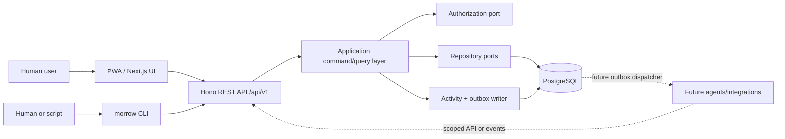
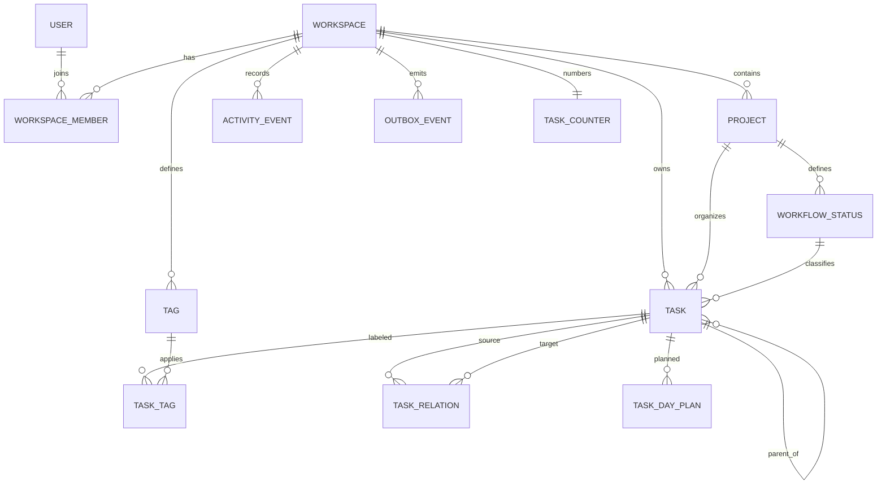
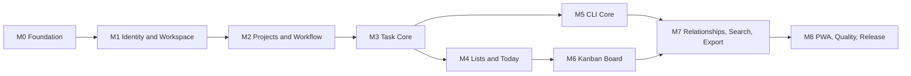

# MorrowList
## Product Specification and Agent Implementation Plan

**Document status:** Approved planning baseline  
**Version:** 1.0  
**Date:** 2026-08-28  
**Primary audience:** Product, design, engineering, QA, DevOps, and coding agents  
**Product stage:** New project; no existing repository  
**Delivery strategy:** Human-usable MVP first; modular updates afterward  

---

## 0. How to Use This Document

This document is the implementation authority for MorrowList until a newer approved version replaces it. It combines the product requirements document, UX specification, technical architecture, data model, API and CLI contracts, quality plan, phased roadmap, and multi-agent execution rules.

Implementation agents must:

1. Read Sections 1–8 before changing architecture or domain behavior.
2. Read the relevant feature section and ticket before beginning work.
3. Treat every item marked **MVP requirement** as mandatory unless an approved architecture decision record changes it.
4. Prefer the simplest implementation that satisfies the stated extension points.
5. Never add speculative agent orchestration, graph rendering, collaboration, or GitHub automation to the MVP merely because this document preserves future support for them.
6. Update tests, contracts, documentation, and migrations in the same change as the feature.
7. Record a new architecture decision record when deviating from a decision in Section 6.

### Requirement language

- **MUST / MUST NOT:** Required for the stated release.
- **SHOULD / SHOULD NOT:** Strong default; deviation requires a reason in the pull request.
- **MAY:** Optional.
- **MVP:** First usable public-quality release.
- **Update:** A release after MVP.
- **Future:** Preserved as an extension point, not scheduled for MVP.

---

# Part I — Product Definition

## 1. Executive Summary

MorrowList is a personal-first task-management product that combines a TODO list and a Kanban board without maintaining two separate kinds of work item. A task is created once and then appears through synchronized views: Inbox, Today, All Tasks, Upcoming, project Board, and later a relationship Graph. Completing, moving, scheduling, or editing a task in any view immediately changes the same canonical task everywhere.

The product should help a user build a durable habit of capturing tasks, choosing what matters today, and visually following work from idea to completion. It should feel faster, calmer, and more coherent than general-purpose project-management products. Its distinguishing long-term direction is that the same system will be usable by humans, command-line clients, integrations, and eventually autonomous or supervised agents.

The MVP is **agent-ready, not agent-powered**. It will not launch or orchestrate agents. It will provide the architectural foundations agents will later need:

- A stable, versioned API and comprehensive CLI
- One canonical task model
- Structured machine-readable responses and errors
- Stable identifiers
- Actor attribution and immutable activity history
- Idempotent mutation support
- Optimistic concurrency control
- Domain events written transactionally
- Explicit permissions and API keys
- Clean ports for integrations, Git providers, workers, and event delivery

The MVP is also **individual-first, team-ready**. A personal workspace is created for every user, while workspace membership and authorization boundaries are modeled from the beginning. Invitations, comments, real-time collaboration, and team administration are postponed.

### 1.1 Product classification

MorrowList is an **equal TODO/Kanban product in the user experience and task-first in the architecture**.

- TODO views optimize capture, daily focus, scheduling, and completion.
- Kanban views optimize workflow visibility, progress, prioritization, and bottleneck discovery.
- The data model stores tasks and statuses—not separate TODO items and cards.
- A board is a view over project tasks grouped by workflow status, not a storage container.

### 1.2 One-sentence value proposition

> MorrowList turns every commitment into one clearly organized task that can be captured instantly, planned for today, moved through a visual workflow, and later operated safely by software agents as well as people.

---

## 2. Product Vision, Goals, and Principles

### 2.1 Vision

MorrowList should become a user’s trusted control surface for work: easy enough for a thought captured in seconds, structured enough for a complex project, visual enough to make progress satisfying, and open enough for agents and integrations to participate without bypassing product rules.

### 2.2 MVP goals

The MVP MUST allow a user to:

1. Create an account and receive a personal workspace.
2. Capture a task in no more than a title.
3. Process Inbox tasks into projects and workflow statuses.
4. Organize work in project Kanban boards.
5. plan and complete work through a deliberate Today view.
6. Find and filter tasks quickly.
7. Create subtasks and task dependencies.
8. use the same core operations from a documented CLI.
9. understand the history of important task changes.
10. install the web app as a PWA and use it responsively on desktop and mobile.
11. export personal data in a documented, versioned format.

### 2.3 Long-term goals

MorrowList SHOULD evolve toward:

- Relationship graph exploration
- Custom motivation and achievement systems
- Recurrence, reminders, and calendar planning
- Team workspaces and collaboration
- Git and GitHub-aware software workflows
- Integration webhooks and an extension SDK
- Supervised and autonomous agent workflows
- Optional AI planning, classification, decomposition, and summarization

### 2.4 Explicit non-goals for the MVP

The MVP MUST NOT include:

- Automatic AI classification, planning, or execution
- Agent registration, routing, leasing, heartbeats, or orchestration
- Graph visualization
- Achievement rules, XP, streak competitions, or currencies
- Team invitations, comments, mentions, presence, or real-time collaborative editing
- GitHub App installation, webhook processing, branch creation, pull requests, or CI synchronization
- Full offline mutation synchronization
- Calendar view or calendar-provider synchronization
- Recurring tasks, notifications, or reminders
- Attachments, rich documents, or file storage
- Time tracking, Pomodoro, habit tracking, or workload planning
- Public sharing or guest access
- Custom fields or no-code automation rules
- Native mobile or desktop applications
- A microservice architecture

### 2.5 Product principles

#### P1. Capture first, organize second
A user must be able to record a task before deciding its project, status, priority, date, or tags.

#### P2. One task, many synchronized views
A task never becomes a separate copy merely because it appears in Today, a list, a board, search, or a future graph.

#### P3. The board must reflect reality
Moving a card changes the task’s status. Completing a task changes its state in every view. The product must not permit visually misleading duplicates.

#### P4. Smoothness is a feature
Interaction latency, keyboard support, sensible defaults, undo, and low-friction editing are product requirements—not finishing touches.

#### P5. Human and machine clients follow the same rules
The web app, CLI, integrations, and future agents must reach the same application commands, authorization checks, validation, audit trail, and events.

#### P6. Modular does not mean prematurely distributed
The MVP should be a modular monolith with enforceable package boundaries. Components may be extracted later without paying the operational cost of microservices now.

#### P7. Motivation should be supportive, not coercive
Future achievements must be optional and user-configurable. The default product should celebrate progress without shame, addictive dark patterns, or manipulative notifications.

#### P8. Data ownership matters
The product must remain self-hostable, exportable, and avoid unnecessary vendor lock-in.

#### P9. Accessibility is part of correctness
Every essential action must work without drag-and-drop and without a pointing device.

---

## 3. Users, Personas, and Jobs to Be Done

### 3.1 Primary MVP persona: Individual knowledge worker

Examples include a student, researcher, developer, product manager, or independent creator.

**Characteristics**

- Manages personal errands and several concurrent projects
- Frequently remembers tasks outside a formal planning session
- Wants a visual sense of progress but also needs a practical daily list
- Is comfortable with common productivity software
- May use desktop for planning and mobile for capture/check-off
- Values ownership, customization, and speed

**Jobs to be done**

- “When I remember something, let me capture it before I lose it.”
- “When I start my day, help me decide what I am intentionally doing.”
- “When a project becomes complex, let me see what is blocked, active, and ready.”
- “When I return after several days, help me recover context.”
- “When I automate my workflow later, let tools use the same safe operations I use.”

### 3.2 Secondary future persona: Team member or lead

This persona needs shared projects, assignments, comments, permissions, notifications, and reporting. The MVP data model must preserve workspace boundaries and membership, but team UX is deferred.

### 3.3 Secondary future persona: Software agent or integration

This actor needs discoverable structured data, stable schemas, scoped credentials, deterministic commands, idempotency, concurrency safety, events, auditability, and explicit failure states. No autonomous behavior is implemented in the MVP.

### 3.4 Reference workflow

The following workflow is the baseline scenario for UX and acceptance testing:

1. The user remembers, “Prepare research presentation,” on a phone and creates it with only a title.
2. The task appears in Inbox.
3. On desktop, the user assigns it to the Research project and the Ready status.
4. The user adds a due date, high priority, and tags.
5. The user creates subtasks: collect sources, make slides, rehearse.
6. “Make slides” is marked as blocked by “Collect sources.”
7. The user adds “Collect sources” to Today.
8. The same task appears in Today, All Tasks, the Research board, and search.
9. Starting it moves the card to In Progress.
10. Completing it unblocks “Make slides.”
11. The final parent task moves through Review and Done.
12. The activity history shows when the task was created, organized, started, rescheduled, and completed.
13. The equivalent sequence can be performed through the CLI using stable task identifiers.

---

## 4. Success Measures

The MVP should be judged primarily by whether it becomes habitual and trustworthy, not by the number of features shipped.

### 4.1 Product outcome metrics

For a hosted beta, measure these events through a replaceable analytics adapter. Self-hosted deployments default to no external analytics.

- **Activation:** User creates at least one project, five tasks, and completes one task within the first seven days.
- **Capture habit:** Median active user creates tasks on at least three distinct days per week by week four.
- **Planning habit:** Median retained user opens Today or a project board on at least four days per week.
- **Workflow adoption:** At least half of retained users move a task between statuses during a week.
- **Retention:** Four-week retained users return in week five.
- **CLI adoption:** Among users who generate an API key, at least one successful CLI mutation occurs.

These are learning metrics, not hard launch gates.

### 4.2 UX quality targets

- Global quick-add opens immediately from any authenticated screen.
- Creating a title-only task requires one text entry and one confirmation action.
- Common optimistic interactions visibly update within 100 ms on the client.
- A normal API mutation should complete within 500 ms at p95 under the MVP reference load.
- A user must be able to operate every core flow by keyboard.
- No successful mutation may be silently lost.
- Failed optimistic updates must roll back and explain what happened.

### 4.3 MVP release gates

The MVP is releasable only when:

- All P0 acceptance criteria pass.
- There are no known critical or high-severity security issues.
- Browser end-to-end tests pass on Chromium, Firefox, and WebKit.
- The CLI parity matrix is complete for required operations.
- The database can be initialized from zero and upgraded from the previous tagged release.
- Export has a documented schema and round-trip fixture test.
- Keyboard and screen-reader smoke tests pass for Inbox, Today, task detail, and Board.
- A self-hosted deployment can start from documented Docker instructions.

---

## 5. Scope and Release Layers

### 5.1 MVP feature set

| Area | MVP requirement |
|---|---|
| Authentication | Email/password; optional GitHub sign-in when configured; secure sessions |
| Workspace | One automatically created personal workspace; workspace-ready authorization model |
| Projects | Create, edit, color/icon, archive, restore, list, and navigate |
| Workflows | Default statuses; create, rename, reorder, recolor, set category, archive safely |
| Tasks | Title, Markdown description, project/Inbox, status, priority, dates, tags, subtasks, dependencies, completion, trash |
| Capture | Global quick-add, Inbox default, board-column add, keyboard shortcut |
| Views | Inbox, Today, Upcoming, All Tasks, project List, project Board, Completed, Trash |
| Today | Overdue, due today, and deliberate My Day selection; no silent rollover |
| Board | Manual ordering, drag/drop, keyboard movement, WIP warning, responsive behavior |
| Search/filter | Title, description, task key, tags; filters encoded in URL |
| Activity | Immutable history for material changes |
| API | Versioned REST API with OpenAPI schema and stable errors |
| CLI | Comprehensive core-operation parity, JSON output, noninteractive mode, API-key auth |
| PWA | Installable manifest, cached shell, offline explanation, recently viewed read cache where safe |
| Data ownership | Versioned JSON export; documented self-hosting |
| Quality | Unit, integration, contract, CLI, and end-to-end tests; accessibility and security checks |

### 5.2 First product update after MVP

The first update SHOULD prioritize the relationship graph:

- Local graph centered on a selected task
- Nodes for tasks and optionally projects
- Edges for dependencies, parent/subtask, and related-to links
- Filters by project, status, relationship, and completion
- Side-panel task inspection
- No graph-only data; all nodes and edges derive from canonical task entities

This update may also include saved views and improvements learned from MVP use.

### 5.3 Subsequent updates

A suggested sequence is:

1. **Graph and saved views**
2. **Motivation framework and user-defined achievements**
3. **Recurring tasks, reminders, calendar view, and offline writes**
4. **Team workspaces, assignment, comments, notifications, and real-time updates**
5. **Manual Git/GitHub references and GitHub App integration**
6. **Agentic workflows and execution adapters**

The sequence may change after user validation. Architectural compatibility is mandatory; premature implementation is not.

---

# Part II — Product and UX Requirements

## 6. Core Product Decisions

### ADR-001 — Canonical task model

**Decision:** Store one canonical Task entity. Board cards and TODO rows are projections of it.

**Consequences:**

- Completion and status changes are globally consistent.
- Today membership is a dated planning relation, not a copied task.
- Future graph nodes reference task IDs.
- CLI and API semantics remain clear.

### ADR-002 — Board is a view, not a container

**Decision:** A project owns tasks and workflow statuses. A board groups project tasks by those statuses.

**Consequences:**

- A task belongs to one primary project at a time.
- A project can later expose several saved board configurations without duplicating tasks.
- Moving between columns changes `status_id` and ordering rank.

### ADR-003 — Modular monolith for MVP

**Decision:** Use one deployable Next.js application plus PostgreSQL, with domain, application, contracts, API, persistence, UI, and CLI separated into packages.

**Consequences:**

- Local development and self-hosting stay simple.
- The API can later be extracted because transport and business logic are already separate.
- No network calls are introduced between internal modules.

### ADR-004 — REST/OpenAPI over browser-only RPC

**Decision:** Expose `/api/v1` as a versioned REST API documented by OpenAPI 3.1.

**Rationale:** Future agents, CLIs, scripts, GitHub Apps, and third-party integrations may not use TypeScript. A language-neutral contract is more important than maximizing browser-only type inference.

### ADR-005 — CLI is a product interface

**Decision:** The MVP CLI must implement the core parity matrix in Section 15. It is not a placeholder or an internal debugging script.

### ADR-006 — Agent-ready, not agent-powered

**Decision:** Implement identity abstraction, activity history, idempotency, concurrency checks, structured errors, and transactional domain events. Do not implement workers, agent routing, execution sandboxes, task leases, model providers, or autonomous state machines.

### ADR-007 — Relationships now, graph later

**Decision:** Model subtasks and task relationships in the MVP. Defer graph rendering to the first major update.

### ADR-008 — Online-first PWA

**Decision:** The MVP is installable and resilient to intermittent connections, but authoritative mutations require a network connection. Full offline writes and conflict synchronization are deferred.

### ADR-009 — Manual ordering is authoritative

**Decision:** Tasks have persistent manual ranks within a status. A user may temporarily sort a view by another property, but drag/reorder is disabled while non-manual sorting is active.

### ADR-010 — Personal-first workspace model

**Decision:** Every user receives a personal workspace and owner membership. Team roles exist in authorization concepts and schema, but team management is hidden until a later release.

---

## 7. Information Architecture and Navigation

### 7.1 Primary hierarchy

```text
User
└── Workspace
    ├── Inbox tasks (no project/status)
    ├── Projects
    │   ├── Workflow statuses
    │   └── Tasks
    ├── Tags
    ├── My Day selections
    ├── Task relationships
    └── Activity events
```

### 7.2 Desktop navigation

```text
MorrowList
├── Quick Add
├── Inbox
├── Today
├── Upcoming
├── All Tasks
├── Projects
│   ├── Project A
│   │   ├── Board
│   │   └── List
│   └── Project B
├── Completed
├── Search
└── Settings
    ├── Appearance
    ├── Workspace
    ├── API Keys
    ├── Data Export
    └── Account
```

### 7.3 Mobile navigation

Mobile uses a bottom bar or compact navigation drawer for Inbox, Today, Projects, Search, and More. Quick Add remains persistently reachable. The Board may switch to a single-status lane with a status selector; status changes must never depend on cross-screen drag gestures.

### 7.4 Default landing behavior

- First authenticated visit: onboarding then Today.
- Returning visit: remember the last primary view on that device.
- When the remembered view no longer exists or is inaccessible: fall back to Today.
- A deep link always wins over remembered navigation.

### 7.5 URL requirements

Routes and filters must be linkable and refresh-safe.

Illustrative routes:

```text
/inbox
/today
/upcoming
/tasks
/projects/:projectId/board
/projects/:projectId/list
/tasks/:taskId
/search?q=report&project=...&priority=high
/completed
/trash
/settings/api-keys
```

Task detail should open as a side panel on wide screens while preserving a canonical URL. Direct visits render a full-page-compatible detail layout.

---

## 8. Task Domain Requirements

### 8.1 Task fields

| Field | MVP | Behavior |
|---|---:|---|
| Stable internal ID | Yes | UUIDv7 generated by the application |
| Human-readable key | Yes | Workspace prefix plus monotonic number, e.g. `ML-142` |
| Title | Yes | Required; 1–500 Unicode characters after trim |
| Description | Yes | Optional Markdown; raw HTML disabled |
| Workspace | Yes | Required and immutable except administrative migration |
| Project | Yes | Nullable; null means Inbox |
| Status | Yes | Required when project is set; null in Inbox |
| Priority | Yes | `none`, `low`, `medium`, `high`, `urgent` |
| Due date | Yes | Date-only supported |
| Due time | Yes | Optional and only valid with due date |
| Due timezone | Yes | Stored when due time exists |
| My Day selection | Yes | Separate dated relation; not a task field copy |
| Tags | Yes | Workspace-scoped, many-to-many |
| Parent task | Yes | Subtasks are full tasks; maximum displayed depth 3 |
| Relationships | Yes | `blocks`, `related_to`; extensible type registry |
| Rank | Yes | Manual fractional rank within Inbox or project status |
| Completion timestamp | Yes | Set when entering a terminal Done status |
| Last active status | Yes | Supports predictable reopen behavior |
| Version | Yes | Incremented on every material mutation |
| Created/updated/deleted timestamps | Yes | UTC timestamps |
| Creator/last actor metadata | Yes | Supports human, API key, system, integration, and reserved agent kinds |

### 8.2 Task invariants

1. A task with no project MUST have no status and appears in Inbox.
2. A task with a project MUST reference a non-archived status belonging to that project.
3. A due time MUST NOT exist without a due date.
4. A task MUST NOT be its own parent or relationship target.
5. Parent chains MUST NOT contain cycles.
6. Relationship endpoints MUST belong to the same workspace.
7. A `blocks` edge MUST be unique for the ordered source/target pair.
8. A `related_to` edge is semantically symmetric and stored in canonical ID order.
9. A completed task MUST have `completed_at`; an incomplete task MUST have `completed_at = null`.
10. Soft-deleted tasks are excluded from normal views and remain restorable.
11. Every material mutation MUST append an activity event in the same database transaction.
12. Every material mutation MUST increment `version`.

### 8.3 Subtasks

- A subtask is a normal Task with `parent_task_id`.
- Subtasks may have their own project, status, priority, dates, tags, and relationships, but the UI SHOULD default a new subtask to its parent’s project.
- MVP UI supports up to three visible nesting levels. The application rejects deeper nesting with `TASK_NESTING_LIMIT_EXCEEDED`.
- Completing all subtasks does not silently complete the parent. The UI offers a one-click “Complete parent” suggestion.
- Completing a parent with incomplete subtasks displays a warning and requires confirmation; the action does not automatically complete children.
- Parent progress is computed as completed direct children divided by total direct children.
- Board views hide subtasks by default and show progress on the parent card. A filter can include them.

### 8.4 Relationships

MVP relationship types:

- `blocks`: Source must be completed before target is considered unblocked.
- `related_to`: Symmetric contextual association.

Behavior:

- A task with at least one incomplete blocking predecessor shows a Blocked indicator.
- The Blocked indicator does not force the workflow status to Blocked; it warns and offers a status change.
- The user may complete a blocked task after an explicit warning. MorrowList should not enforce one universal productivity philosophy.
- Relationship creation and removal are captured in activity history.
- The data model reserves type and metadata fields for future `duplicates`, `informs`, `derived_from`, Git references, and graph presentation.

### 8.5 Completion and reopening

Completing a project task:

1. Resolve the project’s default terminal Done status.
2. Save the prior nonterminal status as `last_active_status_id`.
3. Move the task to Done, place it at the end of that column, set `completed_at`, increment version, and emit events.
4. Remove no tags, dates, relationships, or My Day history.

Completing an Inbox task:

1. Preserve `project_id = null` and `status_id = null`.
2. Set `completed_at`, increment version, and emit events.
3. Remove the task from Inbox and Today’s incomplete sections; show it in Completed.
4. Preserve tags, dates, relationships, and My Day history.

Reopening a task:

1. Clear `completed_at`.
2. For a project task, restore `last_active_status_id` if it still exists and is nonterminal.
3. Otherwise, for a project task, use the project’s default Ready status.
4. For an Inbox task, preserve null project/status and return it to Inbox.

### 8.6 Trash and archival

- Task deletion is soft deletion.
- Trash retains tasks for 30 days by default; self-hosters may configure retention.
- Deleting a parent does not delete children automatically; children become top-level after confirmation.
- Project deletion is represented as archive in MVP.
- Archiving a project hides it from normal navigation but preserves tasks.
- A workflow status can be archived only after its tasks are moved to another status through an atomic operation.


## 9. View Specifications

### 9.1 Inbox

**Purpose:** Capture first; organize later.

**Entry conditions:** A task appears in Inbox when `project_id` and `status_id` are null and it is not deleted or completed.

**Required behaviors:**

- Global quick-add creates in Inbox unless invoked from a specific project/status context.
- Inbox displays title, task key, priority, due information, tags, and age.
- Inline actions: complete, assign project, set date, set priority, add to Today, delete.
- Multi-step organization should be possible without opening full detail.
- Assigning a project also assigns that project’s default Ready status unless another status is explicitly selected.
- Manual ordering is persistent.
- Empty state explains capture and shows the quick-add shortcut.

**Acceptance examples:**

- Given a title-only task created globally, when creation succeeds, then it appears at the top or configured insertion point in Inbox and nowhere as a duplicate.
- Given an Inbox task, when a project is selected, then it leaves Inbox and appears in that project’s List and Board under the default Ready status.

### 9.2 Today

**Purpose:** Show work requiring attention today and work deliberately chosen for today.

Today is the de-duplicated union of:

1. Incomplete overdue tasks
2. Incomplete tasks due today in the user’s workspace timezone
3. Incomplete tasks with a My Day selection for today

**Grouping precedence:**

- Overdue
- Due Today
- My Day

A task satisfying several conditions appears once in the highest-precedence section and displays badges for all applicable reasons.

**Required behaviors:**

- Selecting “Add to My Day” inserts a `task_day_plan` for the current local date.
- My Day does not alter due date or workflow status.
- Selections naturally expire because they are date-bound; no midnight mutation job is required.
- Unfinished manually selected tasks from the previous day produce a review banner on the next visit.
- Review actions: add selected items to today, reschedule individually, dismiss the review, or open the previous day list.
- Tasks do not silently roll forward.
- Inline actions: complete, start, reschedule, change priority, remove from My Day.
- Completing a task follows the global completion rules.

### 9.3 Upcoming

**Purpose:** Provide a lightweight chronological planning view without building a full calendar.

- Show incomplete tasks with future due dates, grouped by date.
- Default horizon: 14 days; configurable to 7, 14, 30, or all upcoming.
- Date-only tasks appear without an artificial midnight timestamp.
- Inline rescheduling is supported.
- Dragging between date groups is optional for MVP; date picker editing is mandatory.

### 9.4 All Tasks and Project List

- All Tasks shows all nondeleted tasks in the workspace, including Inbox tasks.
- Project List scopes to one project.
- Default sort: manual when a meaningful rank scope exists; otherwise updated descending.
- Supported sorts: manual, priority, due date, created date, updated date, title.
- Supported groups: none, project, status, priority, due date.
- Non-manual sort disables row drag and explains why.
- Inline editing supports title, completion, project, status, priority, and due date.
- Filters and sort state are encoded in the URL.
- Completed tasks are hidden by default and available through a toggle or Completed view.

### 9.5 Project Board

**Purpose:** Visualize and change workflow progress.

#### Columns

- One column per active workflow status, ordered by status rank.
- Default statuses:
  1. Backlog
  2. Ready
  3. In Progress
  4. Blocked
  5. Review
  6. Done
- Each status has a semantic category. Names may change without changing category.
- At least one nonterminal status and one terminal Done status must remain.
- Columns can be added, renamed, reordered, recolored, and archived.
- WIP limits are optional integers. Exceeding a limit warns but does not block movement in MVP.

#### Cards

A standard card shows:

- Human task key
- Title
- Priority indicator when not `none`
- Due date/time and overdue state
- Up to three tags plus overflow count
- Subtask progress if applicable
- Blocked indicator if dependencies are incomplete
- My Day indicator when selected today

Cards do not display descriptions by default.

#### Ordering and drag/drop

- Manual order is persisted through fractional rank values.
- The client sends destination status plus neighboring task IDs, not a client-computed authoritative rank.
- The server computes and commits the new rank transactionally.
- The UI applies an optimistic move and rolls back on failure.
- The mutation includes `expectedVersion`; stale changes receive a conflict response.
- A conflict message offers Refresh and Retry rather than silently overwriting another change.
- When a view is sorted by due date, priority, or another automatic sort, dragging is disabled.

#### Non-drag alternatives

Every card menu and keyboard flow must support:

- Move to previous/next status
- Choose any status
- Move before/after another task where practical
- Complete/reopen
- Open details

#### Keyboard behavior

- Arrow keys navigate cards within the board when board navigation mode is active.
- Space selects or “picks up” the focused card.
- Arrow keys choose a destination.
- Space confirms; Escape cancels.
- Screen-reader announcements describe source and destination.
- A simpler card action menu remains available even if drag keyboard mode is disabled.

#### Mobile behavior

- The board may render one active column at a time with a horizontal status selector.
- A task’s status can be changed through a sheet/menu.
- Touch drag may be supported, but it is not a release gate.
- No core action may require precision dragging.

#### Completed cards

- Done cards remain visible on project boards by default, collapsed after the first 20.
- A view option may hide completed cards.
- Auto-archiving completed tasks is not part of MVP.

### 9.6 Completed

- Show tasks ordered by completion time descending.
- Filter by project, date range, priority, and tag.
- Reopen action is available.
- Completion history is not erased by reopening; activity events preserve both transitions.

### 9.7 Trash

- Show deleted tasks with deletion date and scheduled permanent-deletion date.
- Restore and permanently delete are available.
- Permanent deletion requires explicit confirmation and cannot be undone.
- Permanent deletion may be disabled for a short safety window after soft deletion.

### 9.8 Search

Search covers:

- Task title
- Markdown description text
- Human task key
- Tag names
- Project names for navigation results

MVP requirements:

- Debounced interactive search
- Keyboard-accessible result list
- Result highlighting without unsafe HTML
- Filters for project, status, priority, tag, due-date state, completion, and blocked state
- URL-preserved query and filters
- Cursor pagination
- Empty, loading, error, and no-access states

Typo tolerance and semantic/AI search are deferred.

---

## 10. Capture, Editing, and Task Detail

### 10.1 Global quick-add

- Available from every authenticated page.
- Default shortcut: `C`; `Cmd/Ctrl+K` also exposes Create Task.
- Requires only title.
- `Enter` creates; `Escape` closes; `Cmd/Ctrl+Enter` may create from a multiline context.
- Global context defaults to Inbox.
- Project board context defaults to that project and chosen status.
- Today context still defaults to Inbox but adds today’s My Day selection; this behavior must be visually stated.
- The composer preserves input after a recoverable network error.
- Duplicate titles do not block creation.

Natural-language syntax such as `tomorrow #research !high` is explicitly deferred so that unexpected parsing never slows basic capture.

### 10.2 Task detail panel

Sections:

1. Title and completion control
2. Project and status
3. Priority and dates
4. My Day state
5. Tags
6. Description
7. Subtasks
8. Relationships
9. Activity
10. Destructive actions

Behavior:

- Autosave simple field edits after debounce or on blur.
- Show Saving, Saved, and Failed states.
- A failed save preserves the local draft and offers retry.
- Title changes use optimistic concurrency.
- Markdown description uses plain-text editing and sanitized preview; raw HTML is not rendered.
- Activity is read-only and paginated.
- Direct navigation to a task works on mobile and desktop.

### 10.3 Undo

The UI provides an 8-second undo toast for:

- Completion/reopen
- Status movement
- Project assignment
- My Day add/remove
- Soft deletion

Undo issues a compensating command using the latest version. It is not a client-only visual reversal.

### 10.4 Bulk operations

Bulk selection and mutation are not required for MVP. API list endpoints and CLI commands should be designed to add bulk operations later without changing single-item semantics.

---

## 11. Projects and Workflow Configuration

### 11.1 Project fields

- ID
- Workspace ID
- Name, required, 1–100 characters
- Slug, unique within workspace
- Optional Markdown description
- Color token
- Icon identifier
- Archived timestamp
- Version and audit timestamps

### 11.2 Project creation

Creating a project atomically creates the default six statuses. One status is marked default for new tasks, initially Ready. One or more statuses are terminal, initially Done.

### 11.3 Workflow status fields

- Name
- Semantic category: `backlog`, `ready`, `in_progress`, `blocked`, `review`, `done`
- Manual rank
- Color token
- Optional WIP limit
- `is_default_for_new_tasks`
- `is_terminal`, derived or constrained from category
- Archived timestamp
- Version

### 11.4 Workflow constraints

- Exactly one active status is the default for new project tasks.
- At least one active status is terminal.
- Archiving the default status requires choosing a replacement.
- Archiving a status containing tasks requires selecting a destination status; movement and archive occur atomically.
- A status category affects completion and reporting; changing a category displays consequences.
- Moving a task into a Done-category status completes it.
- Moving a completed task to a non-Done category reopens it.

### 11.5 Project move behavior

Moving a task between projects requires selecting or deriving a destination status:

1. Prefer a status in the new project with the same semantic category.
2. If unavailable, use the new project’s default status.
3. Show the resolved destination before confirmation in the UI.
4. Preserve title, description, priority, dates, tags, parent link, and task key.
5. Reject the move if it would create invalid parent or relationship workspace boundaries.

---

## 12. Tags, Dates, and Priority

### 12.1 Tags

- Tags are workspace-scoped.
- A tag has name, normalized name, color token, and optional description.
- Names are case-insensitively unique within a workspace.
- Deleting a tag removes associations but not tasks.
- Tag merging is deferred.
- API responses return tags in a deterministic order.

### 12.2 Priority

Priority ordering:

```text
urgent > high > medium > low > none
```

Priority does not automatically alter status or Today membership.

### 12.3 Date semantics

- Dates are stored separately from optional times.
- Date-only tasks are evaluated in the workspace timezone.
- Timed tasks store an IANA timezone identifier.
- APIs use ISO 8601 values.
- The workspace has a configurable timezone, defaulted from the user/browser during onboarding.
- Changing workspace timezone does not change date-only values.
- For timed tasks, display is converted to the viewer’s selected timezone; original timezone remains available.

---

## 13. Onboarding and Settings

### 13.1 Onboarding

The onboarding flow should be dismissible and consist of:

1. Confirm name and timezone.
2. Create or rename the personal workspace.
3. Optionally create a first project from a small set of examples.
4. Demonstrate quick capture.
5. Land in Today with a sample task only if the user explicitly chose sample data.

No lengthy productivity questionnaire is required.

### 13.2 Settings

MVP settings:

- Appearance: system/light/dark, density, reduced motion preference
- Workspace: name, task-key prefix, timezone
- API keys: create, name, scope, expiration, revoke
- Data export
- Account profile and password/session management
- About/version information

### 13.3 Appearance direction

The visual direction is a calm hybrid:

- Linear-like interaction speed and restraint
- Todoist-like clarity for personal planning
- Warmer Morrow/dawn identity
- Optional celebratory effects kept subtle

Tentative token direction:

- Neutral, low-noise surfaces
- Indigo/violet primary action family
- Warm amber or sunrise accent
- Semantic colors used consistently for urgency, warning, success, and error
- Geist Sans or a comparable open, readable sans-serif; monospace for task keys and CLI examples

Exact colors must pass contrast checks before being frozen. Both light and dark themes are MVP requirements.

---

## 14. Accessibility Requirements

MorrowList targets WCAG 2.2 AA for core workflows.

MUST requirements:

- Logical heading structure and landmarks
- Visible focus indicators
- Complete keyboard access
- Accessible names for icon-only controls
- Drag/drop alternatives and live announcements
- No color-only communication
- Contrast-compliant text and interactive states
- Reduced-motion support
- Correct dialog, side-panel, menu, combobox, and listbox semantics
- Focus return after modal/panel closure
- Error messages linked to their inputs
- Screen-reader-readable saving and error status
- Touch targets suitable for mobile use
- Zoom to 200% without losing core functionality

Automated accessibility tests are necessary but not sufficient. Manual keyboard and screen-reader smoke tests are release gates.

---

# Part III — Technical Architecture

## 15. Selected Technology Stack

### 15.1 Baseline versions

Pin exact patch versions in the lockfile. The planning baseline as of 2026-08-28 is:

| Layer | Selection |
|---|---|
| Runtime | Node.js 24 LTS |
| Language | TypeScript, strict mode |
| Package manager | pnpm workspaces |
| Build orchestration | Turborepo |
| Web framework | Next.js 16 App Router |
| UI runtime | React 19.2 |
| API transport | Hono mounted under Next.js Node runtime |
| API contract | REST `/api/v1`, OpenAPI 3.1, Zod schemas |
| Database | PostgreSQL 18 |
| ORM/migrations | Drizzle ORM and Drizzle Kit; reviewed SQL migrations |
| Authentication | Better Auth behind a local auth adapter |
| Browser server state | TanStack Query |
| Drag/drop | dnd-kit with non-drag alternatives |
| Styling | Tailwind CSS 4 plus accessible headless primitives |
| Component approach | Local design system; shadcn-style source-owned components where useful |
| Unit/integration tests | Vitest |
| Browser E2E | Playwright |
| CLI | TypeScript Node CLI, Commander or equivalent, packaged with `tsup` or equivalent |
| Logging | Structured JSON logs with request and actor context |
| Deployment | OCI/Docker image plus PostgreSQL; vendor-neutral |

### 15.2 Why this stack

#### One language across web, API, domain, contracts, and CLI

TypeScript reduces translation overhead for a new project and allows agents to follow types from UI to persistence. Language-neutral access is preserved through REST/OpenAPI rather than requiring external consumers to run TypeScript.

#### Next.js plus an extractable Hono API

Next.js provides the PWA/web application and a simple initial deployment. Hono gives the API a distinct transport boundary and can run inside Next.js now or move to a standalone Node service later. The application and domain packages remain independent of both.

#### PostgreSQL rather than a document store

Tasks, projects, statuses, tags, relationships, memberships, audit events, and ordering constraints are relational. PostgreSQL also supports transactions necessary for command, audit, and outbox consistency.

#### Drizzle rather than an opaque generated runtime

Drizzle keeps schemas and queries explicit and generates inspectable SQL migrations. Every production migration remains reviewed and committed.

#### Better Auth behind an adapter

Better Auth currently supports session authentication, organizations, API keys, and extensible OAuth capabilities. MorrowList must wrap it so authentication can be replaced without leaking provider-specific models into the domain.

#### No Redis or message broker in MVP

The MVP does not need distributed cache, live presence, or background execution. PostgreSQL and a transactional outbox are sufficient. A queue adapter can be introduced when notifications, GitHub webhooks, or agents require workers.

### 15.3 Technologies intentionally not selected

- **Microservices:** unnecessary deployment and debugging cost.
- **Graph database:** task relationships fit PostgreSQL for MVP and initial graph scale.
- **Firebase/Supabase as a mandatory backend:** managed offerings may be supported, but core architecture remains self-hostable and provider-neutral.
- **tRPC as the public contract:** convenient for TypeScript clients but less appropriate as the primary interface for agents and third parties.
- **Native mobile framework:** responsive PWA first.
- **Event sourcing:** immutable activity and domain events are required; reconstructing all task state from events is not.

## 16. Repository and Module Structure

### 16.1 Proposed monorepo

```text
morrowlist/
├── apps/
│   ├── web/                       # Next.js UI and composition root
│   │   ├── app/
│   │   ├── components/
│   │   ├── features/
│   │   └── public/
│   └── cli/                       # `morrow` command-line application
│       ├── src/commands/
│       ├── src/formatters/
│       └── src/config/
├── packages/
│   ├── domain/                    # Pure entities, value objects, policies, errors
│   ├── application/               # Commands, queries, ports, transaction use cases
│   ├── contracts/                 # Zod request/response/event schemas
│   ├── api/                       # Hono routes, middleware, OpenAPI composition
│   ├── api-client/                # Generated/thin typed client used by web and CLI
│   ├── database/                  # Drizzle schema, repositories, migrations, seeds
│   ├── auth/                      # Better Auth adapter and authorization integration
│   ├── ui/                        # Design tokens and reusable accessible components
│   ├── observability/             # Logging, request IDs, metrics/tracing ports
│   ├── testkit/                   # Builders, fixtures, database helpers
│   └── config/                    # Shared TypeScript, lint, and environment schemas
├── docs/
│   ├── adr/                       # Architecture decision records
│   ├── api/                       # Generated OpenAPI and examples
│   ├── product/                   # Product specs and UX notes
│   ├── runbooks/                  # Deploy, backup, restore, incident guides
│   └── contributing/              # Human and agent contribution rules
├── infra/
│   ├── docker/
│   └── compose/
├── scripts/
├── pnpm-workspace.yaml
├── turbo.json
└── package.json
```

A future `apps/worker` or `apps/api` may be added without moving domain logic.

### 16.2 Dependency rules

```text
UI/Web ────────┐
CLI ───────────┼──> API Client / Contracts
API Transport ─┘             │
                              v
                        Application
                        /           \
                    Domain          Ports
                                      ^
                                      │
                          Database/Auth/Integrations
```

Mandatory constraints:

- `domain` imports no framework, database, HTTP, auth-provider, or UI packages.
- `application` imports `domain` and defines ports; it does not import Next.js, Hono, Drizzle, or Better Auth.
- `database` implements application repository and transaction ports.
- `api` validates transport input, creates actor context, invokes application use cases, and maps errors. It contains no business rules.
- `web` never imports Drizzle schema or repositories.
- `cli` communicates through the public API client; it does not connect directly to PostgreSQL.
- `contracts` contains transport schemas, not mutable domain entities.
- Cross-package imports use public entry points; no deep imports into another package’s internals.
- A dependency-boundary lint check blocks violations.

### 16.3 Feature folder convention in web

```text
features/tasks/
├── api/
├── components/
├── hooks/
├── model/              # View models only, not domain rules
├── routes/
└── tests/
```

Shared components move to `packages/ui` only after at least two real consumers or a clear design-system role. Avoid a premature “utils” dumping ground.

---

## 17. Runtime Architecture

### 17.1 Context diagram



### 17.2 Deployment topology for MVP

```text
Browser / CLI
      |
TLS reverse proxy or managed platform
      |
MorrowList web container
  - Next.js UI
  - Hono API
  - Better Auth endpoints
      |
PostgreSQL 18
```

Optional hosted services such as email delivery, error reporting, or managed PostgreSQL are adapters. Self-hosting must work without proprietary dependencies.

### 17.3 Request flow

1. Next.js/Hono assigns a request ID.
2. Authentication middleware resolves a browser session or API key.
3. Authorization middleware creates `ActorContext`.
4. Zod validates path, query, headers, and body.
5. The route invokes one application command or query.
6. The application service checks workspace scope and domain policy.
7. A transaction mutates data, writes activity, and writes an outbox event.
8. The response maps domain DTOs to versioned contract DTOs.
9. Structured logs record timing and outcome without recording task content by default.

### 17.4 Core application abstractions

```ts
export type ActorKind =
  | "user"
  | "api_key"
  | "system"
  | "integration"
  | "agent"; // reserved for future use

export interface ActorContext {
  actorKind: ActorKind;
  actorId: string;
  userId?: string;
  workspaceIds: readonly string[];
  scopes: ReadonlySet<string>;
  requestId: string;
}

export interface UnitOfWork {
  execute<T>(fn: (tx: TransactionContext) => Promise<T>): Promise<T>;
}

export interface DomainEventEnvelope<T = unknown> {
  id: string;
  schemaVersion: number;
  type: string;
  aggregateType: "task" | "project" | "status" | "tag" | "workspace";
  aggregateId: string;
  workspaceId: string;
  actor: {
    kind: ActorKind;
    id: string;
  };
  occurredAt: string;
  correlationId: string;
  causationId?: string;
  payload: T;
}
```

The `agent` actor kind is reserved but unused in MVP. Its presence prevents future audit schema changes.

---

## 18. Data Model

### 18.1 Entity relationship diagram



### 18.2 Core tables

The following is a logical schema. Agents must implement equivalent Drizzle definitions and reviewed SQL migrations.

#### `workspaces`

| Column | Type | Constraints/notes |
|---|---|---|
| `id` | uuid | PK, application-generated UUIDv7 |
| `name` | varchar(100) | not null |
| `slug` | varchar(80) | not null, unique normalized slug |
| `task_key_prefix` | varchar(10) | not null, uppercase, unique enough for display |
| `timezone` | varchar(100) | IANA identifier, not null |
| `created_by_user_id` | uuid | not null |
| `version` | integer | not null, default 1 |
| `created_at` | timestamptz | not null |
| `updated_at` | timestamptz | not null |

#### `workspace_members`

| Column | Type | Constraints/notes |
|---|---|---|
| `workspace_id` | uuid | FK, composite PK |
| `user_id` | uuid | FK, composite PK |
| `role` | enum/text | `owner`, `admin`, `member`, `viewer` |
| `joined_at` | timestamptz | not null |

MVP creates only owner membership through UI. Authorization code must not assume that every member is owner.

#### `projects`

| Column | Type | Constraints/notes |
|---|---|---|
| `id` | uuid | PK |
| `workspace_id` | uuid | FK, not null |
| `name` | varchar(100) | not null |
| `slug` | varchar(100) | unique within workspace |
| `description_md` | text | nullable |
| `color_token` | varchar(50) | not null |
| `icon` | varchar(80) | nullable |
| `version` | integer | not null, default 1 |
| `archived_at` | timestamptz | nullable |
| `created_by_actor_kind/id` | text pair | actor snapshot |
| `created_at`, `updated_at` | timestamptz | not null |

Indexes: `(workspace_id, archived_at)`, unique `(workspace_id, lower(name))` or an approved relaxed equivalent.

#### `workflow_statuses`

| Column | Type | Constraints/notes |
|---|---|---|
| `id` | uuid | PK |
| `project_id` | uuid | FK, not null |
| `name` | varchar(80) | not null |
| `category` | enum/text | six semantic categories |
| `rank` | varchar(64) | fractional order |
| `color_token` | varchar(50) | not null |
| `wip_limit` | integer | nullable, positive |
| `is_default` | boolean | not null |
| `version` | integer | not null |
| `archived_at` | timestamptz | nullable |
| timestamps | timestamptz | not null |

Indexes: `(project_id, archived_at, rank)`, partial uniqueness ensuring one active default per project.

#### `workspace_task_counters`

| Column | Type | Constraints/notes |
|---|---|---|
| `workspace_id` | uuid | PK/FK |
| `next_number` | bigint | not null |

Allocate task numbers in the same transaction as task creation using row locking or an atomic upsert.

#### `tasks`

| Column | Type | Constraints/notes |
|---|---|---|
| `id` | uuid | PK |
| `workspace_id` | uuid | FK, not null |
| `task_number` | bigint | not null, unique per workspace |
| `project_id` | uuid | nullable FK |
| `status_id` | uuid | nullable FK |
| `title` | varchar(500) | not null |
| `description_md` | text | nullable |
| `priority` | enum/text | not null, default `none` |
| `due_date` | date | nullable |
| `due_time` | time | nullable |
| `due_timezone` | varchar(100) | nullable |
| `parent_task_id` | uuid | nullable self FK |
| `rank` | varchar(64) | not null |
| `last_active_status_id` | uuid | nullable |
| `completed_at` | timestamptz | nullable |
| `version` | integer | not null, default 1 |
| `created_by_actor_kind/id` | text pair | not null |
| `last_actor_kind/id` | text pair | not null |
| `created_at`, `updated_at` | timestamptz | not null |
| `deleted_at` | timestamptz | nullable |
| `deleted_by_actor_kind/id` | text pair | nullable |

Constraints/indexes:

- Unique `(workspace_id, task_number)`
- Index `(workspace_id, deleted_at, completed_at)`
- Index `(project_id, status_id, rank)` for active rows
- Index `(workspace_id, due_date)` for incomplete active rows
- Index `(parent_task_id)`
- Check due-time/date consistency
- Application-level validation that status belongs to project
- Optional normalized search vector added after query profiling; not required initially

#### `tags`

| Column | Type | Constraints/notes |
|---|---|---|
| `id` | uuid | PK |
| `workspace_id` | uuid | FK |
| `name` | varchar(80) | not null |
| `normalized_name` | varchar(80) | not null |
| `color_token` | varchar(50) | not null |
| `description` | text | nullable |
| timestamps | timestamptz | not null |

Unique `(workspace_id, normalized_name)`.

#### `task_tags`

Composite PK `(task_id, tag_id)`, plus `created_at` and actor snapshot if needed for audit. Domain events remain authoritative history.

#### `task_relations`

| Column | Type | Constraints/notes |
|---|---|---|
| `id` | uuid | PK |
| `workspace_id` | uuid | FK |
| `source_task_id` | uuid | FK |
| `target_task_id` | uuid | FK |
| `type` | varchar(40) | MVP: `blocks`, `related_to` |
| `metadata` | jsonb | non-authoritative extension data |
| `created_by_actor_kind/id` | text pair | not null |
| `created_at` | timestamptz | not null |

Unique `(source_task_id, target_task_id, type)`. Canonicalize symmetric relation endpoint order in the application layer.

#### `task_day_plans`

| Column | Type | Constraints/notes |
|---|---|---|
| `task_id` | uuid | composite PK/FK |
| `plan_date` | date | composite PK |
| `source` | varchar(30) | MVP `manual`; future `suggested`, `automation` |
| `created_by_actor_kind/id` | text pair | not null |
| `created_at` | timestamptz | not null |

Index `(plan_date, task_id)`.

#### `activity_events`

| Column | Type | Constraints/notes |
|---|---|---|
| `id` | uuid | PK, UUIDv7 |
| `workspace_id` | uuid | not null |
| `aggregate_type` | varchar(30) | not null |
| `aggregate_id` | uuid | not null |
| `event_type` | varchar(100) | e.g. `task.status_changed` |
| `actor_kind` | varchar(30) | not null |
| `actor_id` | varchar(200) | not null |
| `actor_display_name` | varchar(200) | nullable snapshot |
| `summary` | text | safe human-readable summary |
| `payload` | jsonb | redacted structured diff/details |
| `correlation_id` | uuid/text | request or command correlation |
| `created_at` | timestamptz | not null |

Append-only for application roles. Index `(workspace_id, aggregate_type, aggregate_id, created_at desc)`.

#### `outbox_events`

| Column | Type | Constraints/notes |
|---|---|---|
| `id` | uuid | PK |
| `workspace_id` | uuid | not null |
| `schema_version` | integer | not null |
| `event_type` | varchar(100) | not null |
| `aggregate_type/id` | text/uuid | not null |
| `actor` | jsonb | minimal actor envelope |
| `payload` | jsonb | contract-validated event payload |
| `correlation_id`, `causation_id` | text | traceability |
| `occurred_at` | timestamptz | not null |
| `available_at` | timestamptz | not null |
| `published_at` | timestamptz | nullable |
| `attempts` | integer | default 0 |
| `last_error` | text | nullable, redacted |

MVP writes events and exposes internal inspection/admin tooling. External delivery is deferred. Retention must be configurable.

#### `idempotency_records`

| Column | Type | Constraints/notes |
|---|---|---|
| `workspace_id` | uuid | scope |
| `actor_kind/id` | text pair | scope |
| `key_hash` | varchar | unique with actor/scope |
| `request_fingerprint` | varchar | detects key reuse with different body |
| `status_code` | integer | stored response |
| `response_body` | jsonb | replayable contract response; never contains auth secrets |
| `created_at`, `expires_at` | timestamptz | not null |

Default retention: 24 hours. CLI mutating requests send an idempotency key automatically.

### 18.3 Auth-provider tables

Better Auth tables remain in the same PostgreSQL database but behind `packages/auth`. Domain packages may reference only MorrowList user IDs and authorization ports. No feature package should query provider tables directly.

### 18.4 Future tables not implemented in MVP

Document but do not migrate until their phase begins:

- `saved_views`
- `achievement_definitions`, `achievement_events`, `reward_redemptions`
- `repository_connections`, `external_resources`, `task_code_contexts`
- `integration_installations`, `webhook_subscriptions`, `webhook_deliveries`
- `agent_profiles`, `agent_capabilities`, `task_leases`, `executions`, `execution_artifacts`
- `comments`, `notifications`, `assignments`

---

## 19. Application Commands, Queries, and Events

### 19.1 Command principles

- One command represents one user-visible intention.
- A command performs authorization and validation before mutation.
- All changes, activity, and outbox writes occur in one transaction.
- Commands return a current resource DTO and new version where useful.
- Command handlers are safe to call from API transports other than HTTP.
- API idempotency wraps commands; command code itself should be deterministic.

### 19.2 Required MVP commands

#### Workspace/project/status

- `UpdateWorkspace`
- `CreateProject`
- `UpdateProject`
- `ArchiveProject`
- `RestoreProject`
- `CreateStatus`
- `UpdateStatus`
- `ReorderStatus`
- `ArchiveStatusAndMoveTasks`

#### Task

- `CreateTask`
- `UpdateTaskFields`
- `AssignTaskToProject`
- `MoveTaskToStatus`
- `ReorderTask`
- `CompleteTask`
- `ReopenTask`
- `DeleteTask`
- `RestoreTask`
- `PermanentlyDeleteTask`
- `AddTaskToDay`
- `RemoveTaskFromDay`
- `SetTaskParent`
- `ClearTaskParent`
- `AddTaskRelation`
- `RemoveTaskRelation`
- `AddTaskTag`
- `RemoveTaskTag`

#### Tag/export/API key

- `CreateTag`
- `UpdateTag`
- `DeleteTag`
- `RequestWorkspaceExport`
- API key lifecycle commands delegated through the auth adapter

### 19.3 Required queries

- `GetCurrentUserContext`
- `ListProjects`
- `GetProject`
- `ListWorkflowStatuses`
- `GetTask`
- `ListTasks`
- `GetInbox`
- `GetToday`
- `GetUpcoming`
- `GetProjectBoard`
- `SearchTasks`
- `ListTaskActivity`
- `ListCompletedTasks`
- `ListTrash`
- `GetWorkspaceExport`

### 19.4 Illustrative move command

```ts
export const MoveTaskCommand = z.object({
  taskId: z.uuid(),
  destinationProjectId: z.uuid(),
  destinationStatusId: z.uuid(),
  beforeTaskId: z.uuid().nullable().optional(),
  afterTaskId: z.uuid().nullable().optional(),
  expectedVersion: z.number().int().positive(),
});
```

Handler outline:

```text
authorize workspace task:write
load task and destination status
verify expected version
verify destination status belongs to destination project
resolve project-move rules
lock neighboring rank scope as needed
compute server-side fractional rank
apply status/project/rank transition
apply completion or reopen semantics from destination category
increment version
append activity event
append outbox event task.moved
commit
return task DTO
```

### 19.5 Domain event catalog

MVP event names are versioned by payload schema, not by changing the name for every additive field.

- `workspace.updated`
- `project.created`
- `project.updated`
- `project.archived`
- `project.restored`
- `workflow_status.created`
- `workflow_status.updated`
- `workflow_status.reordered`
- `workflow_status.archived`
- `task.created`
- `task.updated`
- `task.project_changed`
- `task.status_changed`
- `task.reordered`
- `task.completed`
- `task.reopened`
- `task.deleted`
- `task.restored`
- `task.day_added`
- `task.day_removed`
- `task.parent_changed`
- `task.relation_added`
- `task.relation_removed`
- `task.tag_added`
- `task.tag_removed`
- `tag.created`
- `tag.updated`
- `tag.deleted`

### 19.6 Event envelope example

```json
{
  "id": "01996c5d-...",
  "schemaVersion": 1,
  "type": "task.status_changed",
  "aggregateType": "task",
  "aggregateId": "01996c1f-...",
  "workspaceId": "01996b00-...",
  "actor": {
    "kind": "api_key",
    "id": "key_7cf..."
  },
  "occurredAt": "2026-08-28T22:15:00.000Z",
  "correlationId": "req_01...",
  "payload": {
    "taskKey": "ML-142",
    "fromStatusId": "...",
    "toStatusId": "...",
    "version": 8
  }
}
```

Events must not include authentication secrets, full task descriptions, or unnecessary personal data.

---

## 20. REST API Specification

### 20.1 General rules

- Base path: `/api/v1`
- Auth endpoints: `/api/auth/*`
- JSON request/response bodies
- ISO 8601 dates/timestamps
- UTF-8
- Cursor pagination
- OpenAPI 3.1 document generated and committed or reproducibly generated
- `X-Request-Id` accepted or generated and returned
- `Idempotency-Key` supported on every mutating endpoint and automatically used by CLI
- `If-Match` or `expectedVersion` used for conflict-sensitive mutations; use one consistent convention across the API
- Default page size 50; maximum 200
- Unknown response fields must be safely ignorable by clients
- Removing or reinterpreting fields requires a new API version

### 20.2 Error contract

```json
{
  "error": {
    "code": "TASK_VERSION_CONFLICT",
    "message": "The task changed after you loaded it.",
    "details": {
      "taskId": "...",
      "expectedVersion": 7,
      "actualVersion": 8
    },
    "requestId": "req_01..."
  }
}
```

Core error codes:

- `AUTH_REQUIRED`
- `AUTH_FORBIDDEN`
- `WORKSPACE_NOT_FOUND`
- `PROJECT_NOT_FOUND`
- `STATUS_NOT_FOUND`
- `TASK_NOT_FOUND`
- `VALIDATION_FAILED`
- `TASK_VERSION_CONFLICT`
- `TASK_INVALID_STATUS`
- `TASK_NESTING_LIMIT_EXCEEDED`
- `TASK_RELATION_CYCLE`
- `STATUS_ARCHIVE_REQUIRES_DESTINATION`
- `IDEMPOTENCY_KEY_REUSED`
- `RATE_LIMITED`
- `INTERNAL_ERROR`

No stack trace or internal SQL error reaches clients.

### 20.3 Endpoint inventory

#### Context/workspace

| Method | Path | Purpose |
|---|---|---|
| GET | `/me` | Current user, workspace, capabilities |
| GET | `/workspaces` | Accessible workspaces |
| GET | `/workspaces/{id}` | Workspace detail |
| PATCH | `/workspaces/{id}` | Update name, prefix, timezone |

#### Projects/workflows

| Method | Path | Purpose |
|---|---|---|
| GET | `/projects` | List projects |
| POST | `/projects` | Create project and default workflow |
| GET | `/projects/{id}` | Get project |
| PATCH | `/projects/{id}` | Update project |
| POST | `/projects/{id}/archive` | Archive |
| POST | `/projects/{id}/restore` | Restore |
| GET | `/projects/{id}/statuses` | List statuses |
| POST | `/projects/{id}/statuses` | Create status |
| PATCH | `/statuses/{id}` | Update status |
| POST | `/statuses/{id}/reorder` | Reorder status |
| POST | `/statuses/{id}/archive` | Move tasks and archive atomically |

#### Tasks

| Method | Path | Purpose |
|---|---|---|
| GET | `/tasks` | Filtered task list |
| POST | `/tasks` | Create task |
| GET | `/tasks/{idOrKey}` | Task detail |
| PATCH | `/tasks/{id}` | Update simple fields |
| POST | `/tasks/{id}/move` | Change project/status/rank |
| POST | `/tasks/{id}/reorder` | Rank-only change |
| POST | `/tasks/{id}/complete` | Complete |
| POST | `/tasks/{id}/reopen` | Reopen |
| DELETE | `/tasks/{id}` | Soft delete |
| POST | `/tasks/{id}/restore` | Restore from trash |
| DELETE | `/tasks/{id}/permanent` | Permanent deletion |
| POST | `/tasks/{id}/today` | Add to selected date, default today |
| DELETE | `/tasks/{id}/today/{date}` | Remove day selection |
| POST | `/tasks/{id}/parent` | Set parent |
| DELETE | `/tasks/{id}/parent` | Clear parent |
| GET | `/tasks/{id}/activity` | Activity history |

#### Relations/tags

| Method | Path | Purpose |
|---|---|---|
| POST | `/tasks/{id}/relations` | Add relationship |
| DELETE | `/tasks/{id}/relations/{relationId}` | Remove relationship |
| POST | `/tasks/{id}/tags/{tagId}` | Add tag |
| DELETE | `/tasks/{id}/tags/{tagId}` | Remove tag |
| GET | `/tags` | List tags |
| POST | `/tags` | Create tag |
| PATCH | `/tags/{id}` | Update tag |
| DELETE | `/tags/{id}` | Delete tag |

#### Built-in views/search/export

| Method | Path | Purpose |
|---|---|---|
| GET | `/views/inbox` | Inbox projection |
| GET | `/views/today` | Today projection |
| GET | `/views/upcoming` | Upcoming projection |
| GET | `/projects/{id}/board` | Board projection |
| GET | `/search` | Search tasks/projects |
| GET | `/completed` | Completed tasks |
| GET | `/trash` | Deleted tasks |
| POST | `/exports` | Generate export synchronously for MVP-sized data or create job abstraction |
| GET | `/exports/{id}` | Export status/download metadata |

### 20.4 Task create request example

```json
{
  "title": "Prepare research presentation",
  "projectId": null,
  "statusId": null,
  "priority": "none",
  "dueDate": null,
  "dueTime": null,
  "dueTimezone": null,
  "parentTaskId": null,
  "addToDay": "2026-08-28"
}
```

Only `title` is required. The API must distinguish omitted fields from explicitly cleared fields in PATCH requests.

### 20.5 Task list query fields

- `workspaceId`
- `projectId`
- `statusId`
- `priority`
- `tagId`
- `parentTaskId`
- `isCompleted`
- `isBlocked`
- `due=overdue|today|future|none`
- `includeSubtasks`
- `sort`
- `group`
- `cursor`
- `limit`

Complex AND/OR query builders and saved filters are deferred.

### 20.6 Pagination response

```json
{
  "data": [/* resources */],
  "page": {
    "nextCursor": "opaque-or-null",
    "hasMore": true
  }
}
```

Cursors are opaque and signed or otherwise validated. Clients must not construct them.

### 20.7 OpenAPI and compatibility checks

CI must:

- Generate the OpenAPI document from source schemas.
- Fail if generated output differs from the committed document.
- Run contract tests against representative endpoints.
- Detect accidental breaking changes against the last release baseline.
- Generate or validate the TypeScript API client used by web and CLI.

## 21. CLI Specification

### 21.1 CLI goals

The executable name is `morrow`. The CLI is intended for human users, shell scripts, CI jobs, integrations, and future agents. It must be predictable in noninteractive environments.

MUST requirements:

- API-key authentication
- Named profiles for different servers/workspaces
- Structured JSON output
- Stable exit codes
- No prompts when `--no-input` is set
- Useful human-readable output by default
- Filtering and pagination
- Automatic idempotency keys for mutations
- Expected-version support for safe writes
- `--dry-run` for commands where a preview is meaningful
- Clear separation: result data to stdout, diagnostics to stderr
- Secret-safe configuration storage and output
- Shell completion generation or a documented path to add it

### 21.2 Configuration

Configuration precedence:

1. Command flags
2. Environment variables
3. Selected profile
4. Default profile

Suggested variables:

```text
MORROW_BASE_URL
MORROW_API_KEY
MORROW_WORKSPACE
MORROW_PROFILE
MORROW_OUTPUT
MORROW_NO_INPUT
```

Local config path follows operating-system conventions. API keys must not be written with world-readable permissions. `morrow auth status` must never print the complete key.

### 21.3 Command tree

```text
morrow
├── auth
│   ├── login
│   ├── logout
│   ├── status
│   └── profile list|use|set|delete
├── workspace
│   ├── list
│   ├── show
│   └── update
├── project
│   ├── create
│   ├── list
│   ├── show
│   ├── update
│   ├── archive
│   └── restore
├── status
│   ├── list
│   ├── create
│   ├── update
│   ├── reorder
│   └── archive
├── task
│   ├── add
│   ├── list
│   ├── show
│   ├── update
│   ├── move
│   ├── reorder
│   ├── complete
│   ├── reopen
│   ├── delete
│   └── restore
├── today
│   ├── list
│   ├── add
│   └── remove
├── tag
│   ├── list
│   ├── create
│   ├── update
│   ├── add
│   ├── remove
│   └── delete
├── relation
│   ├── list
│   ├── add
│   └── remove
├── search
├── export
└── completion
```

### 21.4 Examples

```bash
# Capture to Inbox
morrow task add "Prepare research presentation"

# Create with structured fields
morrow task add "Collect sources" \
  --project research \
  --status ready \
  --priority high \
  --due 2026-09-02 \
  --today

# Machine-readable list
morrow task list --project research --status ready --json

# Safe update
morrow task update ML-142 --priority urgent --expected-version 7

# Move and order before another task
morrow task move ML-142 --status in-progress --before ML-155

# Relationship
morrow relation add ML-141 blocks ML-142

# Noninteractive scripted use
morrow task complete ML-142 --json --no-input
```

### 21.5 Output envelope

For `--json`, successful singular commands emit the resource directly or a consistent envelope. Choose one convention and use it everywhere. Recommended:

```json
{
  "data": {
    "id": "...",
    "key": "ML-142",
    "title": "Prepare research presentation",
    "version": 8
  },
  "meta": {
    "requestId": "req_01..."
  }
}
```

Errors reproduce the API error code and include a CLI-safe message:

```json
{
  "error": {
    "code": "TASK_VERSION_CONFLICT",
    "message": "The task changed after you loaded it.",
    "requestId": "req_01..."
  }
}
```

Human output should be concise and never require parsing decorative tables in automation.

### 21.6 Exit codes

| Exit code | Meaning |
|---:|---|
| 0 | Success |
| 1 | Unclassified command failure |
| 2 | CLI usage or local validation error |
| 3 | Authentication required/invalid |
| 4 | Permission denied |
| 5 | Resource not found |
| 6 | Version or state conflict |
| 7 | Rate limited or temporarily unavailable |
| 8 | Network failure |
| 9 | Server/internal error |
| 10 | Partial failure in a future bulk operation |

Exit codes must remain backward compatible within major CLI versions.

### 21.7 CLI parity matrix

| Operation | Web | REST API | CLI | MVP gate |
|---|---:|---:|---:|---:|
| Create/read/update/archive project | Yes | Yes | Yes | Required |
| Configure workflow statuses | Yes | Yes | Yes | Required |
| Create/read/update task | Yes | Yes | Yes | Required |
| Assign project/status | Yes | Yes | Yes | Required |
| Reorder/move task | Yes | Yes | Yes | Required |
| Complete/reopen | Yes | Yes | Yes | Required |
| Today add/remove/list | Yes | Yes | Yes | Required |
| Tags | Yes | Yes | Yes | Required |
| Parent/subtask | Yes | Yes | Yes | Required |
| Relationships | Yes | Yes | Yes | Required |
| Search/filter | Yes | Yes | Yes | Required |
| Activity read | Yes | Yes | Optional in CLI MVP | Recommended |
| Trash restore | Yes | Yes | Yes | Required |
| Export | Yes | Yes | Yes | Required |
| Account/password management | Yes | Auth API | No | Not required |
| PWA/install behavior | Yes | N/A | N/A | Web only |

---

## 22. Authentication, Authorization, and API Keys

### 22.1 Authentication

MVP supports:

- Email and password
- Email verification when outbound email is configured
- Password reset when outbound email is configured
- Optional GitHub sign-in controlled by environment configuration
- Secure server-side sessions through Better Auth
- API keys for CLI and automation

A development-only mode may log verification/reset links locally. Production must never expose them in application responses.

### 22.2 Auth adapter boundary

`packages/auth` exposes MorrowList interfaces such as:

```ts
export interface AuthService {
  resolveSession(request: Request): Promise<AuthenticatedPrincipal | null>;
  verifyApiKey(rawKey: string): Promise<AuthenticatedPrincipal | null>;
  createApiKey(input: CreateApiKeyInput): Promise<CreatedApiKey>;
  revokeApiKey(id: string, actor: ActorContext): Promise<void>;
}
```

Feature packages do not call Better Auth directly.

### 22.3 Authorization model

Workspace roles:

- `owner`
- `admin`
- `member`
- `viewer`

MVP user is owner. Policies are still enforced per workspace.

Core scopes:

```text
workspace:read
workspace:write
project:read
project:write
task:read
task:write
tag:read
tag:write
activity:read
export:read
api_key:manage
```

Future scopes may add integration, repository, agent, billing, and administration permissions.

### 22.4 API key requirements

- Key secret shown once on creation.
- Only a secure hash is stored.
- Keys have name, prefix, owner, scopes, optional workspace restriction, optional expiration, creation date, last-used date, and revocation date.
- Default CLI key scopes: read/write tasks, projects, statuses, tags, activity, and export for one workspace.
- API keys cannot manage account security or create broader keys unless explicitly granted.
- Requests identify both the user on whose behalf the key acts and the key actor itself for audit.
- Rate limits can differ by key.
- Revocation takes effect immediately.

### 22.5 Tenant isolation

Every repository query and mutation must include workspace scope from authorized context. Never load by resource ID and then “remember” to check workspace afterward in UI code. Tests must attempt cross-workspace access for every resource family.

---

## 23. Frontend Architecture and State

### 23.1 Rendering strategy

- Next.js App Router renders the authenticated shell and route-level loading/error boundaries.
- Interactive task views are React client components where necessary.
- Server components may prefetch read models, but all core mutations use the public application/API path.
- TanStack Query owns remote server state and optimistic mutation state.
- URL search parameters own shareable filter/sort state.
- Local React state owns ephemeral component state.
- Do not add a global client store until a concrete cross-route need exists.

### 23.2 Query key conventions

```ts
const taskKeys = {
  all: ["tasks"] as const,
  list: (filters: TaskFilters) => ["tasks", "list", filters] as const,
  detail: (id: string) => ["tasks", "detail", id] as const,
  inbox: (workspaceId: string) => ["views", "inbox", workspaceId] as const,
  today: (workspaceId: string, date: string) =>
    ["views", "today", workspaceId, date] as const,
  board: (projectId: string, filters: BoardFilters) =>
    ["projects", projectId, "board", filters] as const,
};
```

Query keys and invalidation rules live with feature API code, not scattered across components.

### 23.3 Optimistic mutation rules

Optimistic updates are allowed for:

- Title and simple metadata edits
- Complete/reopen
- My Day add/remove
- Status move and reorder
- Tag add/remove

Each optimistic mutation must:

1. Cancel relevant queries.
2. Snapshot affected cache entries.
3. Apply one canonical optimistic patch to all known projections.
4. Send expected version and idempotency key.
5. Replace optimistic resource with server response.
6. Roll back every affected projection on failure.
7. Show a specific error and retry action.

Do not duplicate patch logic per view. Implement shared task-cache update helpers.

### 23.4 Component boundaries

Key components:

- `AppShell`
- `Sidebar` / `MobileNavigation`
- `GlobalQuickAdd`
- `CommandPalette`
- `TaskRow`
- `TaskCard`
- `TaskDetailPanel`
- `TaskFieldEditor`
- `DatePicker`
- `TagPicker`
- `ProjectPicker`
- `StatusPicker`
- `PriorityPicker`
- `TodayView`
- `TaskListView`
- `KanbanBoard`
- `KanbanColumn`
- `WorkflowEditor`
- `ActivityTimeline`

Task row/card components consume a normalized `TaskSummaryViewModel`, while task detail consumes a richer DTO. Do not fetch individually inside every card.

### 23.5 Design system

`packages/ui` owns:

- Design tokens
- Buttons, inputs, checkbox, menu, dialog, drawer, tooltip, popover, combobox
- Toast/undo pattern
- Skeleton and empty-state primitives
- Focus ring and reduced-motion behavior
- Theme support

Adopt accessible headless primitives and source-owned components rather than a closed styling framework. Every reusable interactive component needs component tests or focused accessibility tests.

### 23.6 Error and loading states

Every data route must define:

- Initial loading skeleton
- Empty state
- Recoverable API error state
- Not-found state
- Permission-denied state
- Offline state
- Stale/cached data indicator where applicable

Never replace a user’s entire board with a blank screen after one failed background refresh.

---

## 24. Ordering and Concurrency Design

### 24.1 Fractional ranking

Use sortable text ranks or an equivalent fractional-indexing algorithm. Requirements:

- Create a rank between neighboring ranks without rewriting the whole column in normal operation.
- Preserve lexicographic ordering in PostgreSQL.
- Server computes ranks.
- Rebalance a scope only when rank space is exhausted or pathological.
- Rebalance runs transactionally and emits one administrative activity/event summary rather than one noisy event per task.

### 24.2 Concurrent board moves

- Task `version` provides optimistic concurrency.
- Move requests reference before/after neighbors and destination status.
- The server locks the moved task and necessary ordering scope.
- If a referenced neighbor moved or disappeared, the server may recompute a safe nearest position if semantic intent remains clear; otherwise return conflict.
- Duplicate idempotent requests return the original response.
- UI does not silently “last write wins” over a known stale version.

### 24.3 Multiple tabs/devices

Real-time push is deferred. Consistency behavior:

- Refetch on window focus and network reconnect.
- Use reasonable stale times.
- Mutations return current resources and versions.
- Conflict errors prompt refresh/retry.
- Optional browser `BroadcastChannel` may invalidate local same-origin tabs, but is not a substitute for server concurrency control.

---

## 25. PWA and Offline Behavior

### 25.1 MVP PWA scope

- Valid web app manifest
- Application icons and theme metadata
- Installability on supported browsers
- Service worker for static assets and an offline fallback route
- Cache app shell and safe public/static assets
- May cache recently viewed GET responses with a network-first strategy and bounded expiration
- Display a clear offline indicator
- Disable authoritative mutations while offline unless they can be safely held as unsent local drafts
- Preserve quick-add text locally if creation cannot be sent

### 25.2 Explicitly deferred

- General offline mutation queue
- Cross-device conflict merging
- Background synchronization guarantees
- Offline attachment storage
- Push notifications

### 25.3 Cache safety

- Never cache authentication responses or API-key material.
- User-specific API responses require cache names partitioned by signed-in user/workspace and must be purged on logout.
- Version service-worker caches and provide an update-available prompt.
- Avoid cache-first for mutable task API responses.
- Add automated tests for logout cache cleanup and stale-shell upgrade behavior.

---

## 26. Security and Privacy Requirements

### 26.1 Security controls

- TLS in production
- Secure, HttpOnly, SameSite session cookies
- CSRF protection for cookie-authenticated mutations
- Strict origin validation
- Content Security Policy suitable for the selected UI stack
- Input validation at API boundary and domain layer
- Parameterized SQL through Drizzle
- Markdown sanitization and raw HTML disabled
- Rate limiting for auth and mutation endpoints
- Password hashing managed by the auth provider with supported secure defaults
- API-key hashing, scoped permissions, expiration, and revocation
- Workspace isolation on every data access
- Request body limits
- No secrets or full task bodies in logs
- Dependency and container scanning in CI
- Security headers
- Redacted error responses
- Backup encryption according to hosting environment

### 26.2 Activity versus audit

MVP activity history is user-visible product history, not a compliance-grade enterprise audit log. It must be immutable to normal application roles and sufficient to attribute important changes. Enterprise retention, legal hold, administrator export, and tamper-evident signing are future concerns.

### 26.3 Privacy defaults

- No advertising trackers.
- No task content sent to third-party analytics.
- Hosted product analytics records event names and coarse properties only.
- Self-hosted analytics adapter defaults to disabled/no-op.
- No AI provider receives data in MVP.
- Export and account deletion paths are documented.
- Permanent deletion must cascade or anonymize dependent product data according to a tested policy.

### 26.4 Threat scenarios to test

- Cross-workspace ID enumeration
- Stolen/revoked API key
- CSRF against task mutation
- XSS through Markdown, title, tag, or project name
- Malicious cursor/filter values
- Reused idempotency key with changed payload
- Race to exceed ordering constraints
- Unauthorized export
- Session remains after password/security change
- Cached private data visible after logout

---

## 27. Observability and Analytics

### 27.1 Logging

Structured log fields:

- timestamp
- severity
- service/version
- environment
- request ID
- correlation ID
- route template
- HTTP status
- duration
- actor kind and pseudonymous actor ID
- workspace ID where safe
- command/query name
- error code

Exclude task title, description, raw API keys, passwords, session tokens, and complete request bodies by default.

### 27.2 Metrics

Minimum operational metrics:

- Request count, error rate, and latency by route
- Database query/transaction latency
- Connection-pool saturation
- Authentication failures and rate limits
- Command conflicts
- Outbox backlog and write failures
- Export duration/failure
- Client error count when reporting is configured

### 27.3 Product events

Suggested replaceable analytics events:

- `onboarding_completed`
- `task_created`
- `task_completed`
- `task_moved`
- `task_added_to_today`
- `project_created`
- `board_viewed`
- `today_viewed`
- `quick_add_used`
- `cli_key_created`
- `export_requested`

Do not place task content in properties.

---

## 28. Testing Strategy

### 28.1 Test layers

#### Domain unit tests

Fast pure tests for:

- Project/status invariants
- Completion and reopening
- Project moves
- Date semantics
- Parent depth and cycle detection
- Relationship canonicalization and blockers
- Rank calculation
- Authorization policies

#### Application integration tests

Use a real PostgreSQL test database for:

- Transactional command behavior
- Audit and outbox writes
- Idempotency replay and mismatch
- Concurrency/version conflicts
- Tenant isolation
- Status archive/move atomicity
- Task-number allocation
- Query filters and pagination

#### API contract tests

- Zod validation
- Auth/session/API-key behavior
- HTTP status/error mapping
- OpenAPI examples
- Cursor handling
- Backward-compatibility snapshots

#### Component tests

- Quick Add
- Task row/card controls
- Date, project, status, tag pickers
- Task detail autosave/errors
- Board keyboard movement
- Undo toast
- Workflow editor

#### CLI tests

- Argument parsing
- Config precedence
- JSON output schemas
- stdout/stderr separation
- exit codes
- auth redaction
- API error mapping
- idempotency behavior
- integration against a test server

#### End-to-end tests

Critical workflows:

1. Sign up and create first project.
2. Capture to Inbox and organize into a project.
3. Add to Today, complete, and reopen.
4. Drag and keyboard-move cards.
5. Create subtask and blocker relation.
6. Search/filter and open task detail.
7. Archive status while moving tasks.
8. Soft-delete and restore.
9. Create API key and perform CLI task flow.
10. Export data.
11. Logout and verify private PWA cache cleanup.

### 28.2 Browser matrix

Release-gate E2E:

- Current Chromium
- Current Firefox
- Current WebKit
- Desktop viewport
- Representative mobile viewport

Manual smoke tests should include Safari/iOS PWA behavior where available.

### 28.3 Accessibility testing

- Automated axe checks on core routes
- Keyboard-only scripted tests where practical
- Manual VoiceOver or NVDA smoke test
- Reduced-motion verification
- Contrast validation for both themes
- Drag alternative acceptance test

### 28.4 Test data

`packages/testkit` provides deterministic factories and seed scenarios:

- Empty new workspace
- Personal productivity demo
- Research project reference workflow
- Large workspace with 10,000 tasks
- Board with 500 visible cards
- Cross-workspace authorization fixture
- Conflict/idempotency fixture

Do not share mutable fixtures between parallel tests.

### 28.5 Coverage policy

Do not optimize for one global percentage. Release gates:

- Domain and application critical paths have branch coverage.
- Every command has success, authorization, validation, and important conflict tests.
- Every production bug receives a regression test when feasible.
- Generated code and trivial visual wrappers may be excluded with documentation.

---

## 29. Performance and Scalability Targets

### 29.1 Reference scale

The MVP should behave well for:

- 1–20 workspaces per account in future-compatible queries
- 100 projects per workspace
- 10,000 active tasks per workspace
- 100,000 total tasks including completed/trash history
- 500 cards in one board query
- 20 tags per task
- 1,000 activity events on a heavily edited task, paginated

These are engineering test targets, not contractual hosted-plan limits.

### 29.2 Performance budgets

- Initial authenticated shell: usable within 2.5 seconds on a typical modern connection/device.
- Common API reads: p95 under 300 ms at reference scale.
- Common task mutations: p95 under 500 ms.
- Client optimistic feedback: under 100 ms.
- Search: first page under 500 ms at reference scale.
- Board scroll/interaction should remain responsive; avoid rendering unnecessary off-screen detail.

### 29.3 Query discipline

- Select explicit columns.
- Avoid N+1 tag/subtask/relation loading.
- Explain/analyze slow reference queries before release.
- Add indexes based on real query plans.
- Paginate activity, completed, trash, and search.
- Board endpoint returns one normalized projection rather than one request per column.
- Consider virtualization after profiling; do not make drag accessibility dependent on a fragile virtualization implementation.

---

## 30. Export, Backup, and Data Portability

### 30.1 User export

MVP export is a versioned JSON archive containing:

- Export metadata and schema version
- Workspace settings
- Projects and statuses
- Tasks, including completion/deletion state
- Tags and task-tag associations
- Task relationships
- My Day history or a documented retention subset
- Activity events, optionally selected to control size

No auth secrets, password hashes, session tokens, or API-key secrets are exported.

### 30.2 Export schema

```json
{
  "format": "morrowlist-export",
  "schemaVersion": 1,
  "exportedAt": "2026-08-28T22:15:00.000Z",
  "workspace": {},
  "projects": [],
  "statuses": [],
  "tasks": [],
  "tags": [],
  "taskTags": [],
  "relations": [],
  "dayPlans": [],
  "activity": []
}
```

Import UI is deferred, but a validation library and round-trip test fixture should make future import possible.

### 30.3 Operational backup

Self-hosting docs must cover:

- Scheduled PostgreSQL logical or physical backups
- Encryption and retention
- Restore testing
- Migration compatibility
- Backup before risky migrations
- Point-in-time recovery as a recommended production option

A backup is not considered valid until a restore drill succeeds.

---

## 31. Deployment and Environment

### 31.1 Local development

Required developer commands:

```bash
pnpm install
pnpm dev
pnpm test
pnpm test:integration
pnpm test:e2e
pnpm lint
pnpm typecheck
pnpm build
pnpm db:generate
pnpm db:migrate
pnpm db:seed
```

Docker Compose starts PostgreSQL and any development mail catcher. The application may run locally outside Docker for fast reload.

### 31.2 Production image

- Multi-stage Docker build
- Non-root runtime user
- Next.js standalone output where appropriate
- Health and readiness endpoints
- Graceful shutdown
- Runtime environment validation at startup
- Database migrations run as a separate release step, not concurrently in every web instance

### 31.3 Environment variables

Illustrative groups:

```text
# Application
MORROW_ENV
MORROW_BASE_URL
MORROW_LOG_LEVEL
MORROW_VERSION

# Database
DATABASE_URL
DATABASE_POOL_MAX

# Auth
AUTH_SECRET
AUTH_TRUSTED_ORIGINS
GITHUB_CLIENT_ID
GITHUB_CLIENT_SECRET

# Email adapter
EMAIL_PROVIDER
EMAIL_FROM
SMTP_URL

# Optional observability
OTEL_EXPORTER_OTLP_ENDPOINT
SENTRY_DSN
ANALYTICS_PROVIDER

# PWA and retention
TRASH_RETENTION_DAYS
OUTBOX_RETENTION_DAYS
```

Validate variables through a typed schema. Never silently start production with unsafe development defaults.

### 31.4 CI/CD

GitHub Actions or equivalent pipeline stages:

1. Dependency install with frozen lockfile
2. Formatting/lint
3. Type checking
4. Unit tests
5. Integration tests with PostgreSQL
6. OpenAPI generation and breaking-change check
7. Build
8. Browser E2E on protected branches/release candidates
9. Dependency, secret, and container scan
10. Migration validation from clean database and previous release fixture
11. Image build and provenance metadata
12. Deployment only after required approvals

---

## 32. Migration Policy

- Every schema change has a committed SQL migration generated or scaffolded through Drizzle and reviewed by a human/authorized reviewer agent.
- Never use schema “push” against production.
- Prefer backward-compatible expand/migrate/contract changes for deployed environments.
- Destructive migrations require a backup and explicit rollback/recovery plan.
- Application code should tolerate the previous schema during rolling deployment when relevant.
- Migrations must be deterministic and idempotent only where explicitly designed; migration bookkeeping prevents reapplication.
- Seed data is separate from production migrations.
- CI tests new installation and upgrade from the latest tagged schema.

---

# Part IV — Implementation Plan

## 33. Delivery Strategy

The implementation is organized into milestones and tickets. Milestones are dependency boundaries, not calendar promises. Ticket sizes use:

- **S:** narrow change, one primary concern
- **M:** several related files and tests
- **L:** cross-layer feature requiring coordinated work

A ticket is complete only when its acceptance criteria, tests, documentation, and migration/contract updates are complete.

### 33.1 Milestone order



Some tickets inside milestones may run in parallel once shared contracts are frozen.

## 34. Milestone M0 — Foundation

**Goal:** Establish the repository, enforce architecture boundaries, and make every later feature buildable and testable.

| ID | Size | Dependencies | Deliverable and acceptance criteria |
|---|---:|---|---|
| FND-001 | M | None | Scaffold pnpm/Turborepo monorepo with `apps/web`, `apps/cli`, and required packages. `pnpm install`, `pnpm dev`, `pnpm build`, and workspace filtering work from a clean clone. |
| FND-002 | S | FND-001 | Add strict shared TypeScript configs, formatting, linting, import ordering, and package export conventions. CI fails on type errors or boundary-breaking deep imports. |
| FND-003 | M | FND-001 | Implement dependency-boundary rules. `domain` is framework-free; web cannot import database. Add one intentional negative fixture or boundary test. |
| FND-004 | M | FND-001 | Docker Compose for PostgreSQL, `.env.example`, typed environment validation, startup health check, and documented local setup. No secret defaults for production. |
| FND-005 | M | FND-004 | Drizzle package, migration runner, clean-database migration test, seed framework, transaction wrapper, and connection lifecycle. |
| FND-006 | M | FND-001 | Hono API skeleton mounted in Next.js at `/api/v1`; request IDs, JSON error envelope, Zod validation, OpenAPI generation, health/readiness routes. |
| FND-007 | M | FND-001 | Next.js authenticated/unauthenticated shell, theme framework, core design tokens, responsive layout primitives, route loading/error boundaries. |
| FND-008 | S | FND-006 | Structured logging and observability ports; redact secrets/content; correlation ID propagated into application context. |
| FND-009 | M | FND-001 | Vitest, PostgreSQL integration-test harness, Playwright baseline, component-test setup, and test factories package. One test passes at each layer. |
| FND-010 | M | FND-001 | GitHub Actions pipeline for lint, typecheck, unit, integration, OpenAPI diff, build, and basic E2E. Protected-branch documentation included. |
| FND-011 | S | FND-001 | Create ADRs 001–010 from Section 6, contributing guide, agent rules, branch/commit conventions, and ticket template. |

### M0 exit criteria

- Clean clone starts locally from documentation.
- Architecture boundaries are automated rather than relying on memory.
- One API route reaches an application use case and test repository without business logic in the route.
- PostgreSQL migrations work from zero.
- CI is green.

---

## 35. Milestone M1 — Identity and Personal Workspace

**Goal:** A user can sign up, sign in, receive a personal workspace, and safely authorize browser and CLI access.

| ID | Size | Dependencies | Deliverable and acceptance criteria |
|---|---:|---|---|
| AUTH-001 | L | FND-004, FND-005, FND-006 | Better Auth adapter with email/password, session cookies, sign-up/sign-in/sign-out, password reset adapter hooks, and auth database migration. Provider details do not leak into domain/application packages. |
| AUTH-002 | M | AUTH-001 | Optional GitHub sign-in behind validated environment config. App starts normally when credentials are absent. Account-linking behavior is tested. |
| AUTH-003 | L | AUTH-001 | Transactional user bootstrap creates personal workspace, owner membership, workspace counter, and initial settings exactly once. Retried callback is idempotent. |
| AUTH-004 | M | AUTH-003 | `ActorContext`, workspace authorization policies, and API middleware. Cross-workspace access tests cover read and write. |
| AUTH-005 | L | AUTH-001, AUTH-004 | API-key creation/revocation through auth adapter with scopes, optional expiration, workspace restriction, one-time secret display, hashing, and last-used update. |
| AUTH-006 | M | AUTH-003, FND-007 | Sign-up/sign-in/onboarding UI; timezone confirmation; workspace name/prefix; accessible validation and error states. |
| AUTH-007 | M | AUTH-005 | CLI profile/auth foundation: base URL, API key, workspace, secure config permissions, status/logout, environment precedence, secret redaction. |
| AUTH-008 | S | AUTH-001 | Account/session settings page and “sign out all sessions” where provider support is practical; at minimum list current session and secure sign-out. |

### M1 acceptance scenarios

```gherkin
Given a new verified user
When account bootstrap completes
Then exactly one personal workspace and owner membership exist
And repeating the bootstrap does not create duplicates
```

```gherkin
Given a valid API key scoped to workspace A
When it requests a task in workspace B by a known ID
Then the API returns not found or forbidden according to the documented policy
And no resource data from workspace B is exposed
```

---

## 36. Milestone M2 — Projects and Workflow Statuses

**Goal:** The user can organize work into projects with safe customizable Kanban workflows.

| ID | Size | Dependencies | Deliverable and acceptance criteria |
|---|---:|---|---|
| PRJ-001 | M | AUTH-004 | Project and workflow-status schema, repositories, constraints, factories, and migrations. Default workflow creation is transactional. |
| PRJ-002 | L | PRJ-001, FND-006 | Project commands/queries and REST endpoints with activity/outbox infrastructure hooks. OpenAPI and integration tests included. |
| PRJ-003 | M | PRJ-002, FND-007 | Project navigation, create/edit form, icon/color selection, archive/restore, loading/empty/error states. |
| WFL-001 | L | PRJ-001 | Status create/update/reorder policies, semantic categories, one-default and one-terminal invariants, fractional rank service. |
| WFL-002 | L | WFL-001, PRJ-002 | Status API endpoints including atomic archive-and-move contract. Version conflicts tested. |
| WFL-003 | L | WFL-002, PRJ-003 | Workflow editor UI with drag and keyboard reorder, category explanation, WIP limit, safe archive dialog, and accessible controls. |
| PRJ-004 | M | PRJ-002, AUTH-007 | CLI project/status commands with human and JSON output, expected-version support, and exit-code tests. |

### M2 exit criteria

- Creating a project produces the six default statuses in correct order.
- The user can safely customize a workflow without creating a project with no valid default or Done status.
- Web, API, and CLI can perform project/status operations.
- All operations record actor-attributed activity and outbox events once event infrastructure lands in M3; temporary hooks may be completed there before M3 exits.

---

## 37. Milestone M3 — Canonical Task Core

**Goal:** Implement the complete canonical task command model before building all projections.

| ID | Size | Dependencies | Deliverable and acceptance criteria |
|---|---:|---|---|
| TASK-001 | L | PRJ-001, AUTH-004 | Task, counter, day-plan, tag, relation, activity, outbox, and idempotency schemas/migrations. Required indexes and constraints included. |
| TASK-002 | L | TASK-001 | Task domain values/policies: title, priority, dates, Inbox invariant, status/project validation, completion/reopen, nesting, relations, soft delete, actor snapshots. Pure tests cover edge cases. |
| TASK-003 | L | TASK-001, TASK-002 | Task repository/query implementations, task-number allocation, transaction locking, and DTO mappers. Reference-scale integration fixtures pass. |
| EVT-001 | L | TASK-001 | Activity and transactional outbox writer. Every material project/status/task mutation records both in one transaction. Failure rolls back all changes. |
| IDEM-001 | M | TASK-001, FND-006 | HTTP idempotency middleware/storage, request fingerprint, 24-hour expiry, replay behavior, mismatch error, concurrency test. |
| TASK-004 | L | TASK-003, EVT-001, IDEM-001 | `CreateTask`, `UpdateTaskFields`, get/list commands and API routes. Title-only creation works; PATCH distinguishes omitted/cleared values. |
| TASK-005 | L | TASK-004, WFL-002 | Move/reorder/project-change commands with server rank computation, expected version, completion semantics, activity/events, conflict tests. |
| TASK-006 | M | TASK-004 | Complete/reopen/delete/restore/permanent-delete commands and endpoints with retention policy and compensating undo support. |
| TASK-007 | M | TASK-004 | My Day add/remove commands and endpoints with dated uniqueness and actor history. |
| TASK-008 | L | TASK-004 | Tag CRUD and task-tag commands/endpoints; case-insensitive uniqueness and delete behavior tested. |
| TASK-009 | L | TASK-004 | Parent/subtask and relationship commands/endpoints; depth, cycle, workspace, symmetry, and duplicate tests. |
| TASK-010 | M | TASK-004, FND-007 | Global Quick Add UI with Inbox default, contextual project/status creation, optimistic response, keyboard shortcut, offline draft preservation. |
| TASK-011 | L | TASK-004, TASK-008, TASK-009 | Task detail panel/page with autosave states, Markdown editing/preview, selectors, subtasks, relationships, activity placeholder, and destructive actions. |
| TASK-012 | M | TASK-005, TASK-006 | Shared client cache patch/rollback helpers for task mutations across all projections. Unit tests prove one mutation updates detail and list caches consistently. |

### M3 critical acceptance scenarios

```gherkin
Given no project or status is supplied
When a task is created with a nonempty title
Then it receives a stable UUID, workspace task key, rank, version 1, activity event, and outbox event
And it is an Inbox task
```

```gherkin
Given task ML-142 has version 7
When a client submits a mutation expecting version 6
Then no task data changes
And the API returns TASK_VERSION_CONFLICT with the actual version
```

```gherkin
Given a completed task whose prior status was In Progress
When the user reopens it
Then completed_at is cleared
And it returns to In Progress if that status remains active
```

```gherkin
Given two requests with the same idempotency key and identical mutation body
When the second request arrives
Then it receives the first committed response
And no duplicate task, activity event, or outbox event is created
```

---

## 38. Milestone M4 — Inbox, Today, Upcoming, and Lists

**Goal:** Deliver the primary TODO experience on top of canonical task commands.

| ID | Size | Dependencies | Deliverable and acceptance criteria |
|---|---:|---|---|
| VIEW-001 | L | TASK-004, TASK-012 | Inbox query/endpoint/UI with manual ordering, inline organize/date/priority/Today/complete actions, empty and error states. |
| VIEW-002 | L | TASK-004, TASK-012 | All Tasks and Project List query/UI with pagination, group/sort/filter controls, URL state, inline editing, completed toggle. |
| VIEW-003 | L | TASK-007, TASK-012 | Today query and UI with de-duplicated precedence, reason badges, inline actions, timezone tests. |
| VIEW-004 | M | VIEW-003 | Previous-day My Day review banner and actions. No midnight mutation or silent rollover. |
| VIEW-005 | M | TASK-004 | Upcoming query and grouped date UI with horizon selector and rescheduling. |
| VIEW-006 | M | TASK-006 | Completed and Trash views, restore/reopen/permanent-delete flows, retention messaging. |
| VIEW-007 | M | VIEW-001, VIEW-002, VIEW-003 | Command palette for navigation, search entry, and quick creation; keyboard shortcuts help overlay. |
| VIEW-008 | M | VIEW-001, VIEW-002 | Undo toast with server-side compensating commands for required operations. Conflicting undo explains failure. |
| VIEW-009 | S | VIEW-001, VIEW-003 | Responsive mobile navigation and task-list interaction review; all inline actions available through accessible menus/sheets. |

### M4 exit criteria

A user can manage daily work without using the board:

- Capture into Inbox
- Organize tasks
- Deliberately choose Today
- See overdue/due work
- Complete/reopen
- Plan upcoming dates
- Find completed/deleted work

## 39. Milestone M5 — CLI Core

**Goal:** Make the canonical work model fully usable from a stable command-line interface while web views continue in parallel.

| ID | Size | Dependencies | Deliverable and acceptance criteria |
|---|---:|---|---|
| CLI-001 | M | AUTH-007, FND-006 | CLI command framework, config/profile system, API client, version display, update-safe error handling, stdout/stderr rules. |
| CLI-002 | L | TASK-004 | `task add/list/show/update` with all MVP fields, task-key resolution, pagination, filters, JSON schemas, and integration tests. |
| CLI-003 | L | TASK-005, TASK-006 | `task move/reorder/complete/reopen/delete/restore` with expected versions, automatic idempotency, dry-run where meaningful, exit-code mapping. |
| CLI-004 | M | TASK-007 | Today list/add/remove with explicit date and workspace timezone display. |
| CLI-005 | M | TASK-008 | Tag CRUD and task-tag commands. |
| CLI-006 | M | TASK-009 | Parent/subtask and relationship commands with readable direction semantics. |
| CLI-007 | M | PRJ-004 | Harmonize project/status commands with common output, errors, pagination, and profile behavior. |
| CLI-008 | M | CLI-002–007 | Shell completion generation, CLI reference docs, examples for scripts/agents, and golden JSON fixtures. |
| CLI-009 | M | CLI-008 | Package and release CLI for supported Node LTS environments; optional standalone binary investigated but not a gate. Verify install, version, and clean uninstall. |

### M5 release gate

Run the complete reference workflow using only CLI commands against a deployed test instance. The resulting web UI must show the identical task state and activity history.

---

## 40. Milestone M6 — Kanban Board

**Goal:** Deliver the visual workflow experience without creating a second work model.

| ID | Size | Dependencies | Deliverable and acceptance criteria |
|---|---:|---|---|
| BRD-001 | L | TASK-005, VIEW-002 | One board query returns statuses and normalized task summaries without per-column requests or N+1 associations. Filters and completed visibility supported. |
| BRD-002 | L | BRD-001, FND-007 | Board/column/card UI, horizontal desktop layout, responsive mobile lane mode, skeleton/empty/error states, standard card metadata. |
| BRD-003 | L | BRD-002, TASK-012 | dnd-kit move and reorder with optimistic cache update, server-side rank, rollback, auto-scroll, collision tests, and no data loss. |
| BRD-004 | L | BRD-002 | Keyboard move mode, card action alternatives, live announcements, focus management, and accessibility tests. |
| BRD-005 | M | BRD-002 | Column collapse, WIP count/warning, add-task-in-column, Done collapse after threshold, view setting persistence. |
| BRD-006 | M | BRD-003 | Concurrency/conflict UX: stale move notification, refresh/retry, neighboring-task race tests, idempotent replay tests. |
| BRD-007 | M | BRD-002, VIEW-002 | Automatic sort modes with drag disabled and clear explanation; switching back preserves manual ranks. |
| BRD-008 | M | BRD-002 | Performance pass with 500-card fixture, memoization/projection profiling, and documented result. Add virtualization only if profiling justifies it. |

### M6 acceptance scenarios

```gherkin
Given a task is visible in Today and on a project board
When the card moves from Ready to In Progress
Then Today still contains the same task if its Today criteria remain true
And its status changes in every view without duplication
```

```gherkin
Given the board is sorted by due date
When the user attempts to drag a card
Then dragging is unavailable
And the interface explains that manual order is disabled under automatic sorting
```

```gherkin
Given a keyboard-only user focuses a card
When they choose Move and select Review
Then the task moves to Review
And a screen-reader announcement confirms the destination
```

---

## 41. Milestone M7 — Search, Activity, Relationships, and Export

**Goal:** Complete context recovery, data ownership, and the relationship foundation needed for the next graph release.

| ID | Size | Dependencies | Deliverable and acceptance criteria |
|---|---:|---|---|
| SRCH-001 | L | TASK-003, VIEW-002 | Search query/endpoint across title, description, key, tags, and project navigation; filters, cursor pagination, explain-plan test at reference scale. |
| SRCH-002 | M | SRCH-001 | Search page/global palette results, debouncing, highlighting, keyboard behavior, URL state, empty/error cases. |
| ACT-001 | M | EVT-001, TASK-011 | Paginated user-visible task activity with safe summaries and structured details. Actor type/API-key identity displayed appropriately. |
| REL-001 | M | TASK-009, TASK-011 | Refine relationship/subtask UI: blocked indicators on rows/cards, predecessor completion state, add/remove flows, warning before blocked completion. |
| REL-002 | M | REL-001 | Relationship query contract designed for graph update: centered task neighborhood, edge types, depth parameter capped at safe value. Endpoint may remain internal/experimental until graph release. |
| EXP-001 | L | TASK-003 | Versioned JSON export schema and serializer; excludes auth secrets; deterministic fixture and schema validation. |
| EXP-002 | M | EXP-001 | Export settings UI/API/CLI, size/status feedback, secure authorization, retention/cleanup. For MVP-sized data, synchronous generation is acceptable behind a job-like interface. |
| DOC-001 | M | CLI-008, EXP-002 | End-user docs for core flows, CLI, API-key safety, export, and self-hosting; OpenAPI served or published from generated artifact. |

### M7 exit criteria

- Task relationships are useful without the graph.
- The next graph release can query canonical nodes/edges without a migration redesign.
- Search works at reference scale.
- A user can export all product data in a documented format.

---

## 42. Milestone M8 — PWA, Hardening, and MVP Release

**Goal:** Turn the feature-complete system into a trustworthy installable release.

| ID | Size | Dependencies | Deliverable and acceptance criteria |
|---|---:|---|---|
| PWA-001 | M | FND-007 | Manifest, icons, install metadata, offline fallback, service-worker update flow, local/production HTTPS documentation. |
| PWA-002 | L | PWA-001, VIEW-001 | Safe static/read caching, offline indicator, mutation disabling/draft preservation, logout cache purge, automated cache tests. |
| A11Y-001 | L | M4, M6, M7 | WCAG 2.2 AA audit of core flows; automated issues fixed; manual keyboard and screen-reader report committed. |
| PERF-001 | M | M4, M6, M7 | Reference-scale load test and query profiling; performance budgets measured; regressions turned into tests where practical. |
| SEC-001 | L | M7 | Threat-model review, authorization matrix tests, CSRF/XSS/CSP/cache/API-key tests, dependency/container scan, remediation report. |
| REL-003 | M | M7 | Browser and mobile compatibility pass; error/offline/empty/loading states reviewed across routes. |
| OPS-001 | M | FND-010, M7 | Production Dockerfile, health/readiness, migration release job, backup/restore runbook, environment reference, deployment smoke test. |
| OPS-002 | M | OPS-001 | Upgrade test from previous release fixture, migration rollback/recovery rehearsal, export validation after upgrade. |
| QA-001 | L | All | Complete E2E suite across Chromium/Firefox/WebKit, CLI reference workflow, flaky-test remediation, release report. |
| ONB-001 | M | M4 | Onboarding polish, sample data opt-in, first-run analytics hooks, empty-state guidance. |
| RLS-001 | M | All | Versioning, changelog, license/dependency inventory, known limitations, release notes, signed/tagged artifacts, MVP go/no-go checklist. |

### M8 final go/no-go checklist

- [ ] Product acceptance criteria pass.
- [ ] CLI parity matrix complete.
- [ ] No P0/P1 unresolved bugs.
- [ ] No critical/high security findings.
- [ ] Migrations and clean install pass.
- [ ] Backup restore drill passes.
- [ ] Export validates against schema.
- [ ] Accessibility manual report has no blocking issue.
- [ ] Browser matrix passes.
- [ ] Self-hosting docs are reproducible by a clean reviewer.
- [ ] Agent-ready invariants in Section 47 are verified.

---

## 43. Recommended Parallel Agent Execution

### 43.1 Agent roles

These are work partitions, not assumptions about a specific model or vendor.

| Role | Primary ownership |
|---|---|
| Architecture/Domain Agent | `packages/domain`, `packages/application`, ADRs, invariants |
| Data/API Agent | `packages/database`, `packages/api`, migrations, OpenAPI |
| Web/UX Agent | `apps/web`, `packages/ui`, accessibility, responsive behavior |
| CLI Agent | `apps/cli`, `packages/api-client`, CLI docs/fixtures |
| QA/Security Agent | `packages/testkit`, E2E, security tests, performance fixtures |
| Infra/Release Agent | `infra`, CI/CD, Docker, runbooks, release automation |

One human or lead integration agent owns final architectural consistency.

### 43.2 File ownership rules

- An agent may freely modify files in its assigned ticket scope.
- Changes to `packages/contracts` require review from both the consuming client owner and API owner.
- Changes to domain invariants require Architecture/Domain review.
- Migrations require Data/API review and QA upgrade coverage.
- Root configs and dependency upgrades require Foundation/Integration review.
- Do not resolve a merge conflict by discarding another ticket’s behavior.
- Shared file changes should be small, isolated commits.

### 43.3 Parallelization map

#### After M0 contracts and boundaries

Can run in parallel:

- Authentication adapter
- UI shell/design tokens
- CLI config shell
- Database project schema
- Test infrastructure enrichment

#### After project/status contracts

Can run in parallel:

- Project UI
- Project/status CLI
- Task schema/domain
- Activity/outbox infrastructure

#### After task API contracts stabilize

Can run in parallel:

- Task detail/Quick Add
- Inbox/List/Today
- Core CLI task commands
- Board query design
- Search query design

#### After list and board foundations

Can run in parallel:

- Drag/drop
- Keyboard board interaction
- Search UI
- Export
- PWA shell
- Security/scale tests

### 43.4 Integration cadence

- Merge small vertical slices rather than one long-lived branch per milestone.
- A contract PR may land before client implementations, but it must include examples and tests.
- Rebase/merge from the integration branch before requesting final review.
- Feature flags protect incomplete user-visible routes.
- Avoid branches spanning database, API, web, and CLI unless the ticket is intentionally a vertical slice and one owner coordinates it.

---

## 44. Definition of Ready and Definition of Done

### 44.1 Ticket ready checklist

A ticket is ready when:

- User or system outcome is clear.
- Dependencies are merged or mocked through an approved contract.
- Relevant data/API contracts are identified.
- Acceptance criteria are testable.
- Security, accessibility, migration, and observability impact is considered.
- File ownership and reviewer are named.
- No unresolved product decision blocks implementation.

### 44.2 Ticket done checklist

- [ ] Acceptance criteria pass.
- [ ] Domain behavior is not duplicated in UI/API/CLI.
- [ ] Tests cover success and important failures.
- [ ] Authorization and workspace isolation are tested.
- [ ] API/OpenAPI and CLI docs are updated if applicable.
- [ ] Activity/outbox behavior is correct for material mutations.
- [ ] Accessibility is verified for UI changes.
- [ ] Loading, empty, error, conflict, and offline states are addressed.
- [ ] Migration and rollback/recovery notes exist if schema changed.
- [ ] Logs contain no sensitive content.
- [ ] No unused speculative framework was introduced.
- [ ] Changelog entry is added when user-visible.
- [ ] Reviewer can reproduce the change from written steps.

---

## 45. Agent Task Brief Template

Every coding-agent assignment should use a self-contained brief like this:

```markdown
# Ticket: <ID> — <Title>

## Outcome
<What a user or system can do after this change.>

## Context
<Relevant product behavior and architecture decisions.>

## In scope
- ...

## Out of scope
- ...

## Owned files/directories
- ...

## Dependencies
- Merged ticket/contract: ...

## Required contracts
- Request/response/event schema: ...
- Domain command/query: ...

## Acceptance criteria
1. Given ..., when ..., then ...
2. ...

## Required tests
- Unit: ...
- Integration: ...
- E2E/component: ...

## Security/accessibility/observability
- ...

## Completion output
- Code and tests
- Migration/OpenAPI/docs if applicable
- Concise summary of decisions and remaining risks
```

### 45.1 Sample prompt: task create vertical slice

```markdown
Implement TASK-004 CreateTask only. Use the existing CreateTask contract and application ports. Do not add board, agent, recurrence, or natural-language parsing behavior. The route must validate through the shared Zod schema, resolve ActorContext, invoke the application command, and return the contract DTO. The application command must allocate a workspace task number, enforce the Inbox/project-status invariant, create rank/version metadata, append one activity event and one outbox event, and commit atomically. Add domain, PostgreSQL integration, API contract, and authorization tests. Update OpenAPI. Do not import Drizzle from the route or web code.
```

### 45.2 Sample prompt: board drag slice

```markdown
Implement BRD-003 using the existing move endpoint and shared cache helpers. The client may optimistically move the card, but the server remains authoritative for rank and status. Send expectedVersion and an idempotency key. Roll back every affected cache projection on failure. Disable drag when the active sort is not manual. Preserve keyboard/card-menu alternatives implemented in BRD-004; do not hide move functionality behind pointer drag. Add component tests for optimistic success, API failure rollback, and version conflict.
```

### 45.3 Sample prompt: CLI mutation

```markdown
Implement `morrow task complete <idOrKey>`. It must use the public API client, load or accept expected version according to the approved CLI convention, generate an idempotency key, honor profile/env/flag precedence, emit only result data to stdout in JSON mode, map API conflicts to exit code 6, and never print API-key material. Add parser tests, API integration tests, JSON golden fixture, and documentation example.
```

---

## 46. Branching, Commits, and Reviews

### 46.1 Branch naming

```text
feat/TASK-004-create-task
fix/BRD-006-conflict-rollback
docs/DOC-001-self-hosting
chore/FND-010-ci
```

### 46.2 Commits

Use Conventional Commit-style messages with ticket IDs:

```text
feat(tasks): add transactional create command [TASK-004]
test(api): cover idempotent task creation [IDEM-001]
fix(board): rollback all projections on move conflict [BRD-006]
```

Prefer reviewable commits that build and test. Do not mix unrelated formatting across the repository into feature commits.

### 46.3 Pull-request requirements

- Ticket and outcome
- Screenshots/video for material UI changes
- API/CLI examples when contracts change
- Migration and recovery notes
- Test evidence
- Accessibility notes
- Security/privacy impact
- Known limitations
- Checklist from Definition of Done

### 46.4 Review ownership

- Domain invariant: Architecture/Domain reviewer
- Database/migration: Data/API reviewer
- Public API contract: Data/API + CLI/Web consumer reviewer
- Interactive UI: Web/UX + accessibility reviewer
- Auth/security: Security reviewer
- Deployment/migration release: Infra/Release reviewer

---

## 47. Agent-Ready Invariants Required in MVP

This section is the boundary between “ready later” and “implement agents now.” Every item below is required; the agent runtime items after it are prohibited from MVP scope.

### 47.1 Required foundations

1. **Stable IDs:** Internal UUID and human task key are stable across project/status moves.
2. **API parity:** Every material task operation exists in the public versioned API.
3. **CLI parity:** Core operations are callable noninteractively with JSON output.
4. **Actor attribution:** Activity and events distinguish user, API key, system, integration, and reserved agent actors.
5. **Scoped credentials:** API keys have least-privilege scopes, workspace boundaries, expiration, and revocation.
6. **Idempotency:** Automated clients can safely retry mutations.
7. **Concurrency:** Expected versions prevent silent overwrite.
8. **Structured errors:** Machines receive stable error codes and actionable details.
9. **Domain events:** Material state changes produce versioned event envelopes in the transaction.
10. **Audit history:** Humans can understand what changed and which actor changed it.
11. **No UI-only rule:** Business behavior lives in application/domain layers.
12. **Deterministic ordering:** Server controls ranks and resolves moves transactionally.
13. **Capability discovery:** `/me`, OpenAPI, CLI help, and version endpoints expose available operations.
14. **Replaceable adapters:** Auth, event delivery, jobs, analytics, and future Git providers are ports.
15. **Correlation:** Request, command, activity, and event records share correlation identifiers.

### 47.2 Explicitly not implemented in MVP

Do not add:

- Agent profile tables
- Task claiming or leases
- Heartbeats
- Worker registration
- Agent capability matching
- Model/provider calls
- Prompt storage
- Code sandboxes
- Tool permission policies
- Automated repository checkout/edit/test/commit
- Agent execution statuses
- Token/cost budgets
- Automatic task-created wakeups
- Merge/deployment approval gates

These belong to the future design in Section 52.

# Part V — Post-MVP Evolution

## 48. First Update — Relationship Graph

### 48.1 Objective

Help users understand why work is blocked, how subtasks form a larger goal, and which tasks are related without turning the graph into decorative visual noise.

### 48.2 Initial graph modes

1. **Local task graph:** Selected task plus configurable one- or two-hop neighborhood.
2. **Project dependency graph:** Incomplete project tasks and dependency edges.
3. **Filtered relationship graph:** Tasks matching current project/status/tag filters.

A global “everything graph” is not the default because it quickly becomes unreadable.

### 48.3 Node and edge model

Nodes initially represent:

- Tasks
- Optional project grouping/container nodes

Edges represent:

- `blocks`
- `parent_of`
- `related_to`

Future nodes/edges may include goals, people, repositories, commits, pull requests, documents, and agent executions.

### 48.4 Graph UX

- Selecting a node opens canonical Task Detail.
- Completing or moving a task through the detail panel updates all views.
- Filters include project, status category, completion, relationship type, and depth.
- Blocked paths are visually distinguishable without relying only on color.
- Layout is deterministic enough that the graph does not radically jump on every refresh.
- Provide accessible non-canvas relationship list/table alternative.
- Direct edge creation may be added only after task-detail relationship editing is proven.

### 48.5 Technical direction

- Query from PostgreSQL adjacency relations; no graph database initially.
- Add a `RelationshipGraphPort` and graph-specific read model.
- Evaluate rendering libraries during the milestone based on accessibility, performance, layout support, maintenance, and bundle cost. Do not lock a library in MVP.
- Cache layout positions as presentation preferences only, never as relationship truth.

---

## 49. Motivation and User-Defined Achievements

### 49.1 Product direction

Default motivation remains subtle:

- Completion history
- Weekly reflection
- Gentle celebrations
- Optional streaks with grace periods

The differentiating module lets users define personal achievement rules and rewards, for example:

```text
When I complete 3 tasks tagged exercise within 7 days,
unlock the reward "Movie night".
```

### 49.2 Design requirements

- Entire module can be disabled.
- Private by default.
- Rules evaluate domain events, not UI clicks.
- Event replay or bounded recomputation is possible.
- Rewards need not have monetary value.
- Avoid punishment, public shame, manipulative scarcity, or excessive notification loops.
- Rule execution must be deterministic and explain why an achievement triggered.

### 49.3 Future extension points preserved by MVP

- Versioned outbox events
- Stable tags/projects/task IDs
- Actor and correlation data
- Completion timestamps
- Pluggable background job adapter

---

## 50. Team Collaboration

### 50.1 Future capabilities

- Workspace invitations
- Member/admin/guest roles
- Task assignment
- Comments and mentions
- Notifications
- Private projects where needed
- Shared saved views
- Real-time updates/presence where valuable
- Team activity and administrative audit

### 50.2 Architectural impact

- Existing workspace membership becomes user-facing.
- Authorization policies expand rather than being replaced.
- Task assignment is modeled separately from creator/actor.
- Real-time transport is an adapter; PostgreSQL remains source of truth.
- Concurrency controls remain necessary even with live updates.
- Comments and notifications receive their own modules, not JSON fields on tasks.

---

## 51. Git and GitHub Integration

### 51.1 Product objective

Allow software projects to associate task progress with source-control activity, initially for human workflows and later for agents.

### 51.2 Integration phases

#### Phase G1 — Manual code references

- Project may record repository URL/provider metadata.
- Task may attach typed references to issue, branch, commit, pull request, check run, deployment, or release.
- References can be added manually through web/CLI/API.
- No GitHub write permissions or webhooks.

#### Phase G2 — GitHub App read synchronization

- Install GitHub App with least privilege.
- Subscribe to selected webhook events.
- Validate webhook signatures and delivery IDs.
- Link repository, issue, branch, commit, pull request, and check state.
- Update references and optional task status rules.
- Make webhook processing idempotent and asynchronous.

#### Phase G3 — Controlled write actions

- Create/update GitHub issues.
- Open/update pull requests where authorized.
- Comment with task links.
- Create check summaries or commit statuses where appropriate.
- Protected actions use explicit approval and least-privilege installation tokens.

#### Phase G4 — Agent workflows

- Agents create branches/worktrees, commit, open pull requests, report checks, and request approval through an execution adapter.

### 51.3 Future data model

```text
repository_connections
- id, workspace_id, project_id
- provider (github, local_git, gitlab, ...)
- external_owner/repository identifiers
- installation reference
- default branch
- permissions snapshot
- status and timestamps

task_code_contexts
- task_id
- repository_connection_id
- base branch
- working branch
- completion policy

external_resources
- id, task_id, provider, resource_type
- external_id, canonical_url
- state, metadata, last_synced_at
- unique provider/type/external_id

webhook_deliveries
- provider, installation, delivery_id
- signature_verified, event_type
- received/processed timestamps
- attempt/error metadata
```

### 51.4 Completion policies for software projects

Projects may later choose:

- Done when manually completed
- Done when a commit is attached
- Done when a pull request opens and required checks pass
- Done when required review passes and the pull request merges

The recommended software-project default is “required checks pass, review is approved, and pull request is merged,” but completion policy remains configurable.

### 51.5 Git provider abstraction

```ts
export interface GitProvider {
  getRepository(ref: RepositoryRef): Promise<RepositorySnapshot>;
  getPullRequest(ref: PullRequestRef): Promise<PullRequestSnapshot>;
  listChecks(ref: CommitRef): Promise<CheckSnapshot[]>;
  createBranch?(input: CreateBranchInput): Promise<BranchSnapshot>;
  openPullRequest?(input: OpenPullRequestInput): Promise<PullRequestSnapshot>;
}
```

GitHub is the first hosted provider. Local Git remains possible. Do not embed GitHub-specific IDs in Task core columns.

---

## 52. Future Agentic Workflow Architecture

### 52.1 Objective

Enable supervised or autonomous agents to receive eligible tasks, classify and route work, perform actions in external execution environments, report progress and validation, and update canonical MorrowList state with full auditability.

### 52.2 Control-plane/execution-plane separation

**MorrowList control plane owns:**

- Task and workflow state
- Eligibility and approval policy
- Agent identities/capabilities
- Task leases
- Execution requests and status
- Logs/artifact metadata
- Git/GitHub references
- Test/review outcomes
- Cost and retry policy
- Audit/events

**External execution plane owns:**

- Repository checkout/worktree
- Planning
- File edits
- Commands/tests
- Commit/push/pull request operations
- Isolated secrets/tools
- Execution logs and artifacts

MorrowList should not be permanently coupled to one model, agent product, sandbox, or cloud.

### 52.3 Suggested future flow

```mermaid
sequenceDiagram
    participant H as Human/API
    participant M as MorrowList
    participant T as Triage/Router
    participant W as Agent Worker
    participant G as Git Provider/CI

    H->>M: Create or mark task Ready for Agent
    M-->>T: task.ready_for_agent event
    T->>M: classify, add metadata, request assignment
    M->>W: execution request / worker polls
    W->>M: claim lease and start
    M->>M: workflow In Progress; execution Planning
    W->>W: implement and test in sandbox
    W->>G: push branch/open PR
    G-->>M: webhook checks/review state
    W->>M: report artifacts/result
    M->>M: move to Review or Needs Input
    H->>M: approve merge if required
    G-->>M: merged event
    M->>M: complete task under project policy
```

### 52.4 Future entities

- `agent_profiles`
- `agent_capabilities`
- `agent_credentials` references, never raw secrets in task records
- `execution_requests`
- `task_leases`
- `execution_attempts`
- `execution_steps`
- `execution_artifacts`
- `approval_requests`
- `budget_policies`
- `tool_policies`

### 52.5 Separate workflow and execution status

Human-facing workflow remains concise:

```text
Backlog → Ready → In Progress → Blocked → Review → Done
```

Machine execution status may be precise:

```text
queued
triaging
routing
claimed
planning
executing
testing
awaiting_approval
creating_pull_request
ci_running
reviewing
retrying
succeeded
failed
cancelled
```

Do not add every execution state as a Kanban column.

### 52.6 Safety and autonomy modes

Future projects may choose:

- **Manual:** agents act only after explicit invocation.
- **Supervised:** agents plan/implement but protected operations require approval.
- **Autonomous:** agents act within bounded policies.

Recommended initial agent release: supervised. Agents may edit, test, commit, and open pull requests, but cannot merge protected branches or deploy without project policy approval.

### 52.7 Required future reliability controls

- Expiring task leases and heartbeats
- Idempotent steps and webhook handling
- Sandboxed execution
- Capability- and scope-based tools
- Secret isolation
- Bounded retries and exponential backoff
- Needs-human-input terminal path
- Checkpoints and resumability
- Cost/token/time budgets
- Immutable logs and artifact hashes
- Human cancellation
- Scope-change detection
- Approval before sensitive paths, merge, deployment, or budget overrun

The MVP foundations in Section 47 exist so these capabilities can be added without rewriting Task core.

---

# Part VI — Acceptance, Risks, and Governance

## 53. Priority User Stories and Acceptance Criteria

### US-001 — Capture immediately

**As a user, I want to create a task with only a title so I do not lose an idea.**

```gherkin
Given I am signed in on any application route
When I open Quick Add, type a valid title, and submit
Then the composer closes or clears according to the interaction design
And a task is created in Inbox
And it receives a stable key and version
And it is visible in Inbox without a full page reload
```

### US-002 — Organize Inbox work

```gherkin
Given an Inbox task
When I assign it to a project without choosing a status
Then the project default status is applied
And the task disappears from Inbox
And the same task appears in the project List and Board
```

### US-003 — Plan My Day

```gherkin
Given an incomplete task not due today
When I add it to My Day
Then it appears in Today for the workspace-local date
And its due date and status do not change
```

### US-004 — Avoid silent rollover

```gherkin
Given a manually selected My Day task was unfinished yesterday
When I open Today on the next day
Then the task is not silently selected for the new day
And a review interface offers explicit actions
```

### US-005 — Move work visually

```gherkin
Given a Ready task on a manually ordered board
When I move it between In Progress cards
Then the UI updates optimistically
And the server records destination status and rank
And the task status is updated in every view
And activity identifies the actor
```

### US-006 — Complete consistently

```gherkin
Given an incomplete project task visible in Board and Today
When I check it complete in Today
Then it moves to the project Done status
And completed_at is set
And the board displays it as Done
And no duplicate remains in Today
```

### US-007 — Understand blocking

```gherkin
Given task A blocks task B and A is incomplete
When I view task B
Then B shows an incomplete blocker
And I can navigate to A
And completing B remains possible only after a warning
```

### US-008 — Recover from conflict

```gherkin
Given two clients loaded version 4 of a task
When client one saves version 5 and client two then attempts a conflicting write expecting version 4
Then client two receives TASK_VERSION_CONFLICT
And its optimistic UI rolls back
And the user can refresh and retry
```

### US-009 — Script the workflow

```gherkin
Given a scoped API key and CLI profile
When a script creates, moves, relates, and completes a task with --json --no-input
Then every command returns stable JSON and exit codes
And the web UI shows identical canonical state
And activity identifies the API key actor
```

### US-010 — Own the data

```gherkin
Given a workspace with projects, tasks, tags, relations, and history
When the owner requests an export
Then the downloaded JSON validates against the documented schema
And contains no auth secrets
And repeated exports do not mutate product data
```

### US-011 — Use without drag

```gherkin
Given a keyboard-only user on a project board
When they select a card's Move action and choose another status
Then the task moves successfully
And focus remains in a predictable location
And the change is announced
```

### US-012 — Work during connection loss

```gherkin
Given the installed PWA loses network connectivity
When I navigate to a recently available route
Then the shell and safe cached data render with an offline indicator where available
And unsupported mutations are disabled or preserve a local draft
And the app never falsely reports a server mutation as complete
```

---

## 54. Risk Register

| Risk | Likelihood | Impact | Mitigation |
|---|---:|---:|---|
| Scope expands into AI/team/graph before core feels smooth | High | High | Enforce MVP non-goals and feature flags; no future table migrations without phase approval. |
| “Agent-ready” creates excessive abstractions | Medium | High | Require each foundation to serve current API/CLI/audit correctness; no worker/orchestration code in MVP. |
| Kanban drag becomes fragile or inaccessible | Medium | High | Server-authoritative move command, non-drag alternatives first, keyboard tests, profile before virtualization. |
| Manual rank conflicts under concurrent moves | Medium | Medium | Fractional ranking, version checks, transactional server computation, rebalance strategy, race tests. |
| PWA caching leaks or shows stale private data | Medium | High | Network-first private data, user-partitioned caches, logout purge, automated security tests. |
| Custom workflows create invalid completion behavior | Medium | High | Semantic categories and invariants; one default and terminal status; atomic archive/move. |
| Next.js/framework churn affects implementation | Medium | Medium | Pin patches, wrap Hono/API/domain boundaries, scheduled dependency updates, no canary releases in production. |
| Better Auth coupling limits future licensing/hosting | Low–Medium | Medium | Auth adapter; domain never imports provider schema/API. |
| Search is slow at large history sizes | Medium | Medium | Cursor pagination, query plans, indexes, introduce Postgres full-text/trigram after profiling. |
| Activity/outbox grows without bound | Medium | Medium | Retention policies, pagination, archival/cleanup runbook, minimal payloads. |
| CLI behavior drifts from web/API | Medium | High | Parity matrix, same public API client/contracts, CLI reference E2E. |
| Cross-workspace authorization bug | Low–Medium | Critical | Workspace-scoped repositories, policy layer, adversarial tests on every resource family. |
| Self-hosting documentation becomes untested | Medium | Medium | Clean-environment deployment test before release and reproducible Docker path. |
| User motivation features become manipulative | Low now | Medium later | Optional module, privacy by default, explicit ethical design rules, user-controlled rewards. |
| GitHub integration receives excessive permissions | Medium later | High | GitHub App, least privilege, installation-scoped tokens, signed webhooks, separate phased rollout. |
| Future agents duplicate actions or run forever | Medium later | Critical | Idempotency, leases, heartbeats, bounded retries, budgets, approvals, resumability. |

---

## 55. Open Decisions and Assumptions

These decisions do not block MVP planning; they should be validated before or during the indicated milestone.

| Topic | Current assumption | Decision point |
|---|---|---|
| Public/open-source license | Build with clean dependency licensing and self-hostability; choose publication/business license after MVP validation | Before public repository release |
| Hosted deployment vendor | Vendor-neutral Docker/Postgres; select convenience host later | M8 |
| Email provider | Adapter; development mail catcher; hosted provider later | M1/M8 |
| Optional GitHub sign-in | Enabled only when credentials configured | M1 |
| Exact component primitives | Accessible source-owned/headless components; avoid provider lock-in | M0 |
| Exact fractional-rank implementation | Evaluate a small proven implementation or internal module; server-owned contract fixed | M2/M3 |
| Product analytics provider | No-op interface for self-hosting; hosted provider selected later | M0/M8 |
| Error reporting provider | Optional adapter, likely Sentry-compatible; not mandatory for self-host | M8 |
| Graph renderer | Select during graph update based on accessibility/performance | Post-MVP |
| Permanent deletion grace period | Default 30-day Trash; immediate permanent action may require short safety delay | M3/product review |
| Markdown editor | Plain textarea + preview in MVP; richer editor later | M3 |
| Standalone CLI binaries | Node package is required; standalone binaries optional | M5 |

### 55.1 Assumptions approved from discovery

- Product name: MorrowList.
- No existing repository or codebase.
- MVP first, grown in modular layers.
- Individuals first; future teams supported by architecture.
- Responsive web/PWA first.
- Cloud-deployable and self-hostable.
- Graph is the first major update, not MVP.
- Calm hybrid UI, light and dark modes.
- Intentional My Day model.
- Default workflow includes Backlog, Ready, In Progress, Blocked, Review, Done.
- CLI is required in MVP.
- Agent orchestration is not implemented now.
- Git/GitHub integration and automated software workflows are future phases.

---

## 56. Architecture Decision Record Index

Create these files in `docs/adr/` during M0:

| ADR | Title |
|---|---|
| 0001 | Canonical Task Across Synchronized Views |
| 0002 | Board as Projection of Project Workflow |
| 0003 | Modular Monolith for MVP |
| 0004 | Versioned REST and OpenAPI Public Contract |
| 0005 | CLI as a First-Class Product Interface |
| 0006 | Agent-Ready Foundations Without Agent Runtime |
| 0007 | PostgreSQL and Drizzle Persistence |
| 0008 | Online-First PWA and Deferred Offline Writes |
| 0009 | Fractional Manual Ordering and Optimistic Concurrency |
| 0010 | Personal-First Workspace and Future Team Authorization |
| 0011 | Transactional Activity and Outbox Events |
| 0012 | Better Auth Behind a Replaceable Adapter |
| 0013 | Graph Relationships in PostgreSQL Before Graph Database |
| 0014 | GitHub App as Future Hosted Git Integration |

---

## 57. Reference Implementation Checklist

### Repository

- [ ] pnpm/Turborepo monorepo
- [ ] strict TypeScript
- [ ] dependency boundaries
- [ ] reproducible lockfile
- [ ] environment validation

### Backend

- [ ] Hono `/api/v1`
- [ ] OpenAPI 3.1
- [ ] PostgreSQL migrations
- [ ] transactional command/activity/outbox
- [ ] idempotency
- [ ] expected versions
- [ ] tenant isolation

### Web

- [ ] responsive shell
- [ ] Inbox/Today/Upcoming/All Tasks
- [ ] project List/Board
- [ ] Quick Add and task detail
- [ ] light/dark
- [ ] keyboard and screen reader support
- [ ] optimistic rollback/conflict UI
- [ ] PWA install/offline explanation

### CLI

- [ ] profiles/API-key auth
- [ ] task/project/status/tag/relation/Today commands
- [ ] JSON output
- [ ] stable errors and exit codes
- [ ] no-input and idempotency
- [ ] parity E2E

### Operations

- [ ] Docker deployment
- [ ] clean install and upgrade migration tests
- [ ] backup/restore runbook
- [ ] structured logs
- [ ] security scan
- [ ] export schema
- [ ] release checklist

---

## 58. Official Technical References

These references validate the selected stack and future integration direction. Exact dependency versions must be pinned and rechecked when implementation begins.

- Next.js documentation: https://nextjs.org/docs
- Next.js PWA guide: https://nextjs.org/docs/app/guides/progressive-web-apps
- React versions: https://react.dev/versions
- Node.js release schedule: https://nodejs.org/en/about/previous-releases
- pnpm workspaces: https://pnpm.io/workspaces
- Turborepo documentation: https://turborepo.com/docs
- PostgreSQL current documentation: https://www.postgresql.org/docs/current/
- Drizzle migrations: https://orm.drizzle.team/docs/migrations
- Hono with Next.js: https://hono.dev/docs/getting-started/nextjs
- Zod documentation and JSON Schema: https://zod.dev/ and https://zod.dev/json-schema
- Better Auth documentation: https://www.better-auth.com/docs
- Better Auth API keys: https://better-auth.com/docs/plugins/api-key
- TanStack Query: https://tanstack.com/query/latest/docs/framework/react/overview
- dnd-kit: https://dndkit.com/
- Vitest: https://vitest.dev/guide/
- Playwright: https://playwright.dev/docs/intro
- GitHub Apps: https://docs.github.com/en/apps/creating-github-apps/about-creating-github-apps/about-creating-github-apps
- GitHub webhooks: https://docs.github.com/en/webhooks
- GitHub Checks API: https://docs.github.com/en/rest/checks

---

## 59. Final Product Boundary

The first MorrowList release is successful when it is an unusually smooth personal task system with a real Kanban workflow, deliberate daily planning, trustworthy data behavior, and a CLI that can perform the same work as the web app.

It does **not** need to prove autonomous agents, team collaboration, achievements, graph rendering, or GitHub automation in the MVP. It does need to prove that those capabilities can be added through explicit modules and public contracts rather than by bypassing or rewriting the task core.

The implementation test for every architectural choice is therefore:

> Does this make today’s human workflow simpler and safer while preserving a clean, documented path for tomorrow’s machine workflow?

If the answer serves only the imagined future and burdens the MVP, defer it. If the answer makes current API/CLI behavior deterministic, auditable, secure, and modular, it belongs in the foundation.
